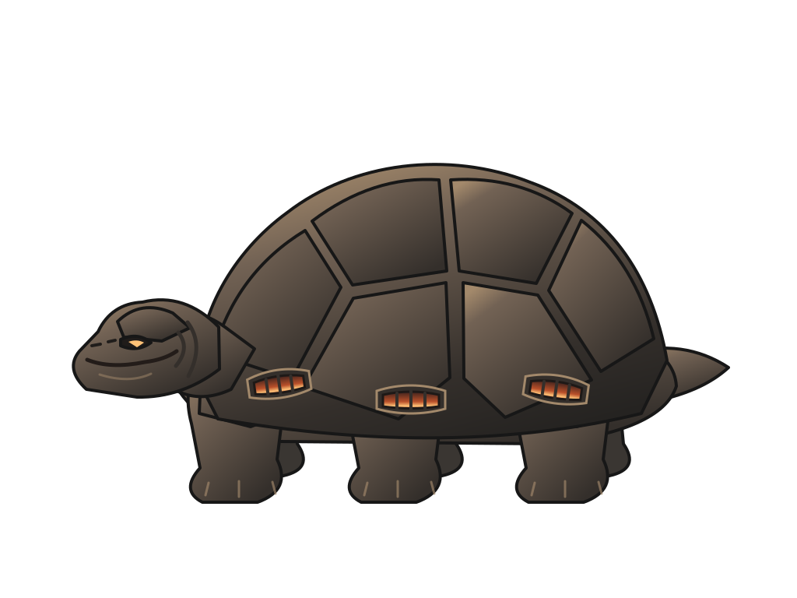
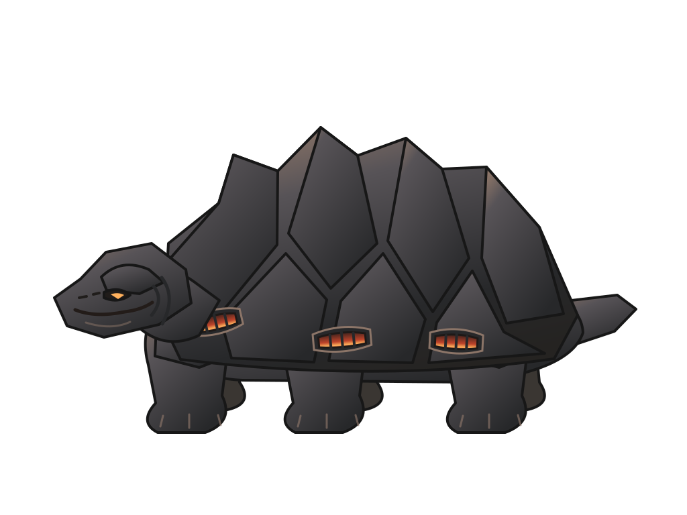
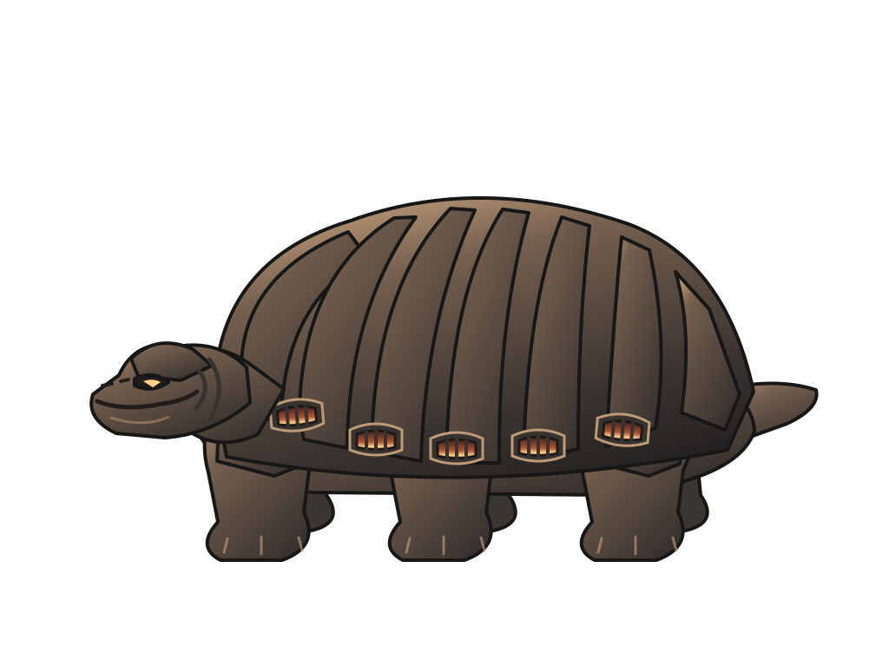
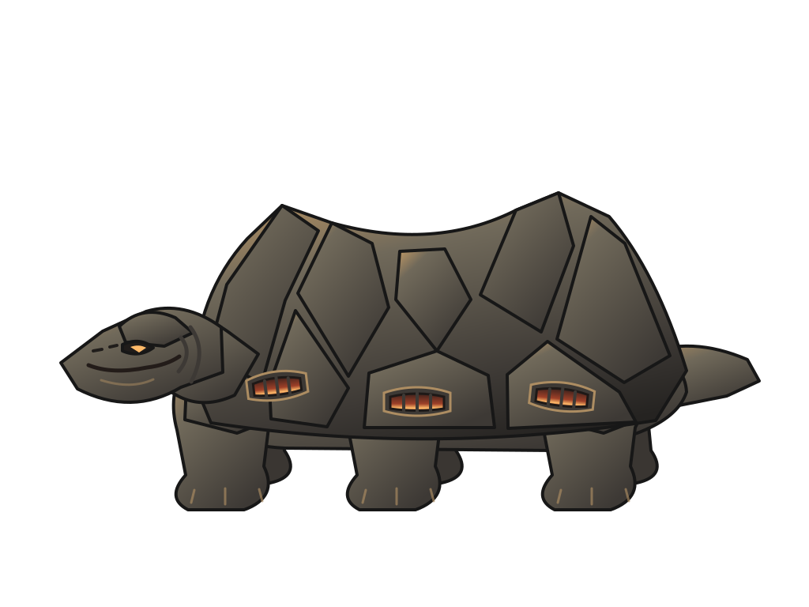
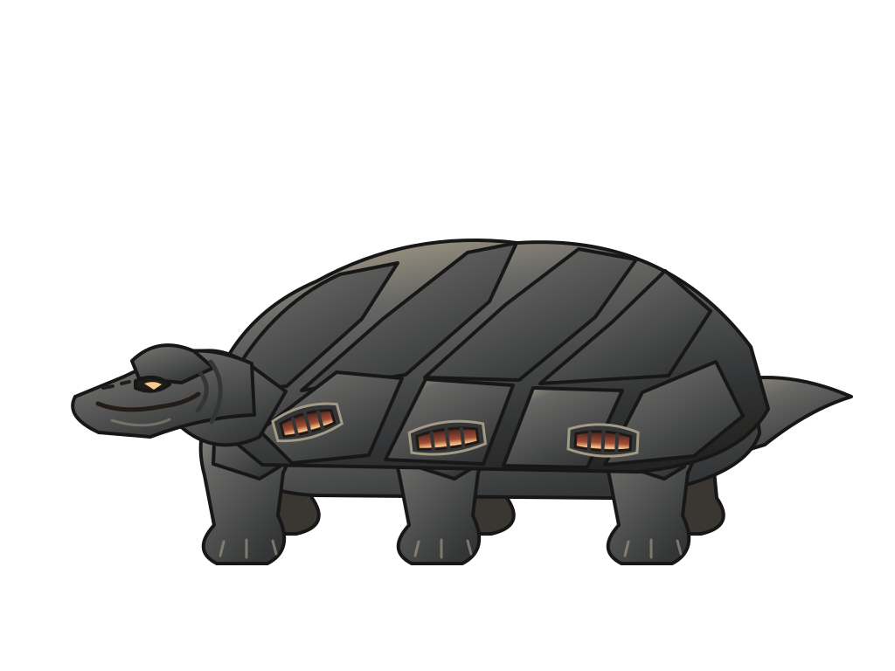

# Avarn — five physical concept studies (candidate)

Owner requests five distinct physical concepts and separate images. Historical foundation remains accepted; no visual lock. Image generation unavailable in this session; original manually authored vector silhouette/anatomy studies only, not photoreal or final TRELLIS inputs. All retain six weight-bearing limbs (three per side), layered refractory plates, restrained recessed heat vents, blunt muzzle, no wings, no gear. Proposed dimensions are comparison scale, not canon. No changes to accepted history, Hearth Gate or gameplay.

## 1. Kilnback Colossus

- Scale: 5.8 m long, 2.7 m high (candidate)
- Anatomy/materials: Broad low domed torso; layered overlapping radial scutes, blunt oval head, six thick elephantine legs, short tapered tail. Three broad shutter slots inset under each flank. Matte black basalt, warm sienna skin, tarnished bronze-colored growth rings, restrained amber glow.
- Movement: Slow alternating tripod gait, shell shutters open in sequence; low head bow. Strongest match to existing history.
- Risk: Generic lava tortoise if vents and face are not distinctive.

## 2. Cinder-Crowned Sentinel

- Scale: 6.2 m long, 3.1 m high (candidate)
- Anatomy/materials: Heavy forward shoulders, angular ridge of broad swept-back plates, tapering rear carapace, wide wedge skull with a shieldlike brow, six braced pillar legs. Recessed paired chest-side vents, no horns or external flames. Graphite obsidian, oxidized copper edges and deep vermilion recesses.
- Movement: Front pair anchors as shoulder plates lift; measured middle/rear steps, assertive head turn.
- Risk: Aggressive silhouette could undermine his watchful, non-vindictive character.

## 3. Ember Vault

- Scale: 5.4 m long, 2.5 m high (candidate)
- Anatomy/materials: Flattened barrel body with six articulated curved vault ribs, long recessed channels under a smooth dorsal cap, muscular neck with a small blunt seal-like muzzle, six broad padded limbs, short flexible rudder tail. Dark ash, russet leathery skin, pale ceramic plate rims and honey-colored internal heat.
- Movement: Ribs expand and settle like a breathing bellows; shutters close individually during rest.
- Risk: Must read as living biology, not a manufactured furnace or mechanical construct.

## 4. Caldera Warden

- Scale: 6.7 m long, 2.9 m high (candidate)
- Anatomy/materials: Oval body with tall curved perimeter plates around a recessed central heat basin; overlapping scutes form a natural caldera ring, no exposed lava pool. Wide shovel-like head with protective cheek plates, six squat outward-splayed legs, broad low tail. Weathered charcoal, ochre mineral deposits, muted red internal channels.
- Movement: Outer plates fold inward over recessed vents; crouches to protect heat and rises slowly.
- Risk: Top ring may collect visual clutter and requires careful occlusion and silhouette testing.

## 5. Ashveil Pilgrim

- Scale: 5.9 m long, 2.3 m high (candidate)
- Anatomy/materials: Longer lower body, flowing shingle-like layered plates rather than round shell; soft dark terracotta skin, long low neck and narrow but blunt muzzle, six articulated reptilian legs with broad pads; flattened tapered tail. Slate-grey ash patina, rust-red underplates and tiny gold vent seams.
- Movement: More mobile long-stride gait; overlapping plates shift as he turns, settles like a low banked hearth.
- Risk: Less imposing than the Colossus; maintain monumental weight and avoid salamander resemblance.

Owner selection required before detailed painted art, front/side/back turnaround and TRELLIS/BART model pipeline. Keep Water held. No actual 3D or new power kit.
