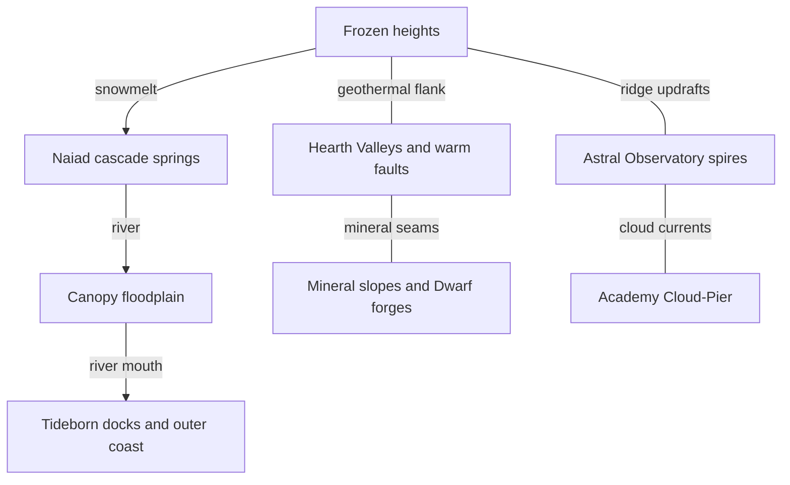

# AlderVale: Pact of Ten — Element Design v1

| Field | Value |
| --- | --- |
| Design ID | `aldervale-element-system-v1` |
| Type | Cross-element rule |
| Status | Creature and fusion rules decided for v1. Other design areas are proposed. |
| Source baseline | [`295a25c7facabf7d350c951817ba0a1af7b1612a`](https://github.com/vixttha/AlderVale-Pact-of-Ten/commit/295a25c7facabf7d350c951817ba0a1af7b1612a) |
| Related design or issue | [Element registry](../element-registry.md), [Fusion System v1 proposal](../fusion-system-v1.md), [prestige lineages #47](https://github.com/vixttha/AlderVale-Pact-of-Ten/issues/47), [spell progression #68](https://github.com/vixttha/AlderVale-Pact-of-Ten/issues/68) |

## Identity and lore

AlderVale has six starter elements, four rare elements, and five fusion elements. Each has a named crest and color pair. The combat roles below are design identities from the catalog. The setting details come from creature lore and describe those creatures' place in the world.

| Element | Combat identity | Creature lore anchor | Crest |
| --- | --- | --- | --- |
| Ember | Burst damage and burning | Hearth Kitsune warm kettle-ovens in the Hearth Valleys. | Flame Diamond |
| Frost | Defense, shields, and chill | Glacier Stags drink at Naiad cascade springs. | Six-Point Crystal |
| Gale | Speed, accuracy, and evasion | Sky-Avians train Gale Barn-Owls to carry sealed letters between cloud strata. | Twin Pinion Spiral |
| Bramble | Healing, thorn wards, and sustain | Mosscap Budlings chime when rain gathers in the Canopy greenhouse. | Thorn Tri-Leaf |
| Tide | Flow control and cleansing | Tidepool Otters collect sea-glass around Tideborn dock lanterns. | Cresting Wave Ring |
| Spark | Volatile attacks and critical hits | Nimbus Lynx fur crackles during dusk cloud-storms. | Jagged Bolt |
| Umbra | Drain and weakening | Dark Elf archivists guide Nocturne Luna-Moths under lantern-lit root arches. | Crescent Nocturne |
| Sol | Radiant attacks and team support | Suncrest Gryphons guard High Elf scholarly battlements. | Solar Starburst |
| Verdigris | Rune-forged armor pierce | Dwarf smiths bring Anvil-Sprite Golems to life. | Forged Anvil Hex |
| Chronos | Pip tempo and precision | Pendulum Automatons are attuned to Astral Observatory spires. | Twin Hourglass |
| Magma | Area pressure and crust defense | Caldera Newt hatches from Ember and Bramble. | Cracked Caldera |
| Tempest | Charged multi-target pressure | Maelstrom Eel hatches from Tide and Spark. | Maelstrom Eye |
| Glacier | Barriers and freezing strikes | Permafrost Seal hatches from Frost and Tide. | Faceted Iceberg |
| Eclipse | Drain and radiant bursts | Corona Caracal hatches from Umbra and Sol. | Corona Ring |
| Aetheris | Precise, piercing attacks | Astrolabe Dragonet hatches from Chronos and Verdigris. | Celestial Astrolabe |

The [element catalog](https://github.com/vixttha/AlderVale-Pact-of-Ten/blob/295a25c7facabf7d350c951817ba0a1af7b1612a/shared/elements.ts#L24) defines the named crests and palettes. The [creature catalog](https://github.com/vixttha/AlderVale-Pact-of-Ten/blob/295a25c7facabf7d350c951817ba0a1af7b1612a/shared/creatures.ts#L24) supplies the lore anchors. Dedicated sounds for each element remain open. The fusion proposal describes a separate elemental consciousness for each fusion and an individual personality for its creature. Both are draft lore.

## Current mechanics and sources

| Game behavior | Observed rule | Source or evidence |
| --- | --- | --- |
| Matchup order | A mirror hit uses **0.85×**. The attacker's direct opposing element uses **1.25×**. If a fusion attacks an element opposed by one of its parents, it uses **1.15×**. Other matchups use **1.00×**. The separate fusion bonus is directional. | [Matchup function](https://github.com/vixttha/AlderVale-Pact-of-Ten/blob/295a25c7facabf7d350c951817ba0a1af7b1612a/shared/elements.ts#L242) |
| Foundational opposing pairs | Ember ↔ Frost, Gale ↔ Bramble, Tide ↔ Spark, Umbra ↔ Sol, Verdigris ↔ Chronos. The spell damage path applies matchup before the target shield. Creature strikes also use the matchup helper. | [Element definitions](https://github.com/vixttha/AlderVale-Pact-of-Ten/blob/295a25c7facabf7d350c951817ba0a1af7b1612a/shared/elements.ts#L24), [spell damage](https://github.com/vixttha/AlderVale-Pact-of-Ten/blob/295a25c7facabf7d350c951817ba0a1af7b1612a/shared/combat.ts#L328), [creature strikes](https://github.com/vixttha/AlderVale-Pact-of-Ten/blob/295a25c7facabf7d350c951817ba0a1af7b1612a/shared/combat.ts#L554) |
| Status vocabulary | Burning, Stunned, Regen, Frostbite, and Shocked are status kinds. Spell-specific magnitudes and durations live in the spell records. | [Status types](https://github.com/vixttha/AlderVale-Pact-of-Ten/blob/295a25c7facabf7d350c951817ba0a1af7b1612a/shared/combat.ts#L6), [spell catalog](https://github.com/vixttha/AlderVale-Pact-of-Ten/blob/295a25c7facabf7d350c951817ba0a1af7b1612a/shared/spells.ts) |
| Rare-element spells | Umbra, Sol, Verdigris, and Chronos each have a rank-1 native attack. Advanced rare spells marked with an element requirement need rank 4 and that element's Rare Trial unlock. | [Rare spell definitions](https://github.com/vixttha/AlderVale-Pact-of-Ten/blob/295a25c7facabf7d350c951817ba0a1af7b1612a/shared/spells.ts#L90), [purchase and use gates](https://github.com/vixttha/AlderVale-Pact-of-Ten/blob/295a25c7facabf7d350c951817ba0a1af7b1612a/shared/spells.ts#L123) |
| Fusion spell progression | Each listed fusion spell requires its catalog rank and the matching entry in `unlockedFusions`. New wizard data initializes that list empty. The inspected hatch reward updates eggs and bestiary but leaves the list unchanged. Acquisition and persistence of a matching unlock remain unverified end to end. | [Spell gates](https://github.com/vixttha/AlderVale-Pact-of-Ten/blob/295a25c7facabf7d350c951817ba0a1af7b1612a/shared/spells.ts#L123), [wizard initialization](https://github.com/vixttha/AlderVale-Pact-of-Ten/blob/295a25c7facabf7d350c951817ba0a1af7b1612a/shared/economy.ts#L195), [hatch reward save](https://github.com/vixttha/AlderVale-Pact-of-Ten/blob/295a25c7facabf7d350c951817ba0a1af7b1612a/src/App.tsx#L980) |
| Hatchery | The player selects two distinct owned creatures and pays **80 Florins**. A compatible pair determines the fusion species in either order. An incompatible pair picks a parent species. An egg hatches after **two eligible wins**. The inspected reward handler returns before egg progression for live PvP and co-op. | [Egg creation](https://github.com/vixttha/AlderVale-Pact-of-Ten/blob/295a25c7facabf7d350c951817ba0a1af7b1612a/src/features/creatures/CreaturesArborPanel.tsx#L127), [duel reward handler](https://github.com/vixttha/AlderVale-Pact-of-Ten/blob/295a25c7facabf7d350c951817ba0a1af7b1612a/src/App.tsx#L898), [fusion resolver](https://github.com/vixttha/AlderVale-Pact-of-Ten/blob/295a25c7facabf7d350c951817ba0a1af7b1612a/shared/creatures.ts#L297) |

### Fusion spell reference

These are catalog inputs. The base value is the input to combat resolution. Each row also requires its matching fusion unlock. [Spell definitions](https://github.com/vixttha/AlderVale-Pact-of-Ten/blob/295a25c7facabf7d350c951817ba0a1af7b1612a/shared/spells.ts#L106)

| Element | Signature spell | Kind | Pips | Base value | Minimum rank |
| --- | --- | --- | ---: | ---: | ---: |
| Magma | Tectonic Eruption | Area attack | 5 | 490 | 3 |
| Tempest | Sky-Sea Maelstrom | Area attack | 6 | 610 | 3 |
| Glacier | Permafrost Tide | Attack | 5 | 470 | 3 |
| Eclipse | Corona Requiem | Drain | 6 | 590 | 5 |
| Aetheris | Astrolabe Zenith | Attack | 7 | 690 | 6 |

## Proposed mechanics

- **Birth and requirements.** An exact compatible pair forms a Confluence Egg in the Hatchery, with a guaranteed species and both parents retained. See the [v1 creature and fusion rules](#v1-creature-and-fusion-rules) for eligibility, cost, and incubation.
- **Identity and lore.** Each fusion has one combat identity and a distinct Confluence consciousness. Its creature has an individual personality and can sense that consciousness. The [fusion proposal](../fusion-system-v1.md) carries the five lore profiles and describes how the creature's awareness changes by stage.
- **Matchups and counterplay.** Review attacker and defender directions in a full 15 × 15 table before changing the current helper. For each proposed modifier, record which stage of damage calculation it affects, which shield or status rules apply, and what the player can do in response.
- **Spells and statuses.** Review the five existing spells against their cost, effect, targeting, and counterplay before adding any fusion-exclusive status.
- **Progression and persistence.** The [v1 creature and fusion rules](#v1-creature-and-fusion-rules) define qualifying wins and save behavior. The matching unlock and signature-card grant are in the game source through [PR #107](https://github.com/vixttha/AlderVale-Pact-of-Ten/pull/107).

## Creatures and fusion lineage

The five parent pairs, species, and stage names below are defined in the [creature catalog and resolver](https://github.com/vixttha/AlderVale-Pact-of-Ten/blob/295a25c7facabf7d350c951817ba0a1af7b1612a/shared/creatures.ts#L24). Tide appears in two recipes. Gale has none in the current catalog.

| Fusion | Parents | Species | Stage 1 → Stage 2 → Stage 3 |
| --- | --- | --- | --- |
| Magma | Ember + Bramble | Caldera Newt | Cinder Tadpole → Basalt Salamander → Obsidian Caldera |
| Tempest | Tide + Spark | Maelstrom Eel | Spark Fin → Storm Serpent → Sovereign Maelstrom |
| Glacier | Frost + Tide | Permafrost Seal | Ice Pup → Rime Guardian → Glacier Monarch |
| Eclipse | Umbra + Sol | Corona Caracal | Twilight Kit → Corona Lynx → Eclipse Sovereign |
| Aetheris | Chronos + Verdigris | Astrolabe Dragonet | Starlight Wyrm → Gilded Astrolabe → Aetheris Sovereign |

Bond stage is **1 below 100 XP**, **2 at 100–299 XP**, and **3 at 300 XP or more**. Stage names and thresholds are source-backed. Stage-specific visuals and dialogue remain open for review. [Bond stage helper](https://github.com/vixttha/AlderVale-Pact-of-Ten/blob/295a25c7facabf7d350c951817ba0a1af7b1612a/shared/creatures.ts#L307)

### v1 creature and fusion rules

Decision made November 16, 2026, on the owner's request to select the v1 rules. The following rules define the intended player behavior. The source check below identifies differences that still need implementation.

| Rule | v1 decision |
| --- | --- |
| Recipes | Retain the five exact unordered pairs in the lineage table above. Each always yields its named species and fusion affinity. Gale has no fusion recipe in v1. |
| Lifelong affinity | Every creature has one permanent affinity from its species. Evolution and bond growth retain it. An ordinary offspring has its inherited species' affinity. |
| New egg eligibility | Choose two distinct creatures owned by the active wizard in the current realm. Keep both parents. The price is **80 Florins per egg**. Stage 1 parents qualify and the Hatchery requires no Bonding Seal. Validate the pairing before charging. |
| Ordinary eggs | For two non-fusion parents outside the five recipes, choose one of their species with an equal chance per parent and store the result once at purchase. A fusion and a non-fusion parent produce the non-fusion parent's species. Two fusion parents are ineligible and incur no charge. |
| Incubation | New eggs hatch after **two distinct claimed wins** in local **Solo, Rare Trial, or Spire**. A qualifying claim advances each pending egg for that wizard once, with or without a lead creature participating. Losses, draws, abandonments, spectating, live PvP, live co-op, and repeat claims add zero. |
| Paid eggs | Honor each existing egg's stored result, recorded wins and required wins, including a fusion result from the older fallback. Keep the egg's identity when loading a save. Apply the new outcome rules to newly purchased eggs only. Charge no additional fee and grant one offspring when the saved threshold is met. |
| Hatch rewards | Persist the offspring and the egg's removal together. A fusion result also grants its matching unlock and signature card once, including a saved legacy fusion result. Preserve the rank gate for using the card and existing deck choices. A retry or reload preserves the recorded outcome. |

Keeping one price and the existing local progression path makes the rules predictable for players. The exact pair supplies the fusion gate. Incubation still gives players two battles between buying the egg and seeing their creature hatch.

At the [reviewed game commit](https://github.com/vixttha/AlderVale-Pact-of-Ten/commit/219a6bda1f9b2e01f06fd97350a66ed8f470f0d1), the [pair resolver](https://github.com/vixttha/AlderVale-Pact-of-Ten/blob/219a6bda1f9b2e01f06fd97350a66ed8f470f0d1/shared/creatures.ts#L297) uses the five unordered recipes. The [purchase handler](https://github.com/vixttha/AlderVale-Pact-of-Ten/blob/219a6bda1f9b2e01f06fd97350a66ed8f470f0d1/src/features/creatures/CreaturesArborPanel.tsx#L127) still uses a random parent-species fallback for all unmatched pairs. The [reward claim](https://github.com/vixttha/AlderVale-Pact-of-Ten/blob/219a6bda1f9b2e01f06fd97350a66ed8f470f0d1/src/features/duel/DuelArenaModal.tsx#L399) calls the [game reward handler](https://github.com/vixttha/AlderVale-Pact-of-Ten/blob/219a6bda1f9b2e01f06fd97350a66ed8f470f0d1/src/App.tsx#L904), which excludes live matches and increments pending eggs on a local win. The [merged grant](https://github.com/vixttha/AlderVale-Pact-of-Ten/blob/219a6bda1f9b2e01f06fd97350a66ed8f470f0d1/src/App.tsx#L986) covers hatch entitlements. The new fusion-parent restrictions and once-per-win save behavior are implementation requirements to verify.

## 4. Creature biology

**Status** · v1 inheritance rules selected. Lore portrayal is proposed. Each creature hatches with one elemental affinity. Parentage, evolution stage, and learned behavior describe different parts of its identity.

### Can two different elements produce offspring?

Yes. Same-element non-fusion parents pass on their shared affinity. For two different non-fusion elements, an exact match in the five-pair lineage table produces its named fusion species through a Confluence Egg, with the same result in either parent order. Other pairings that produce an ordinary egg pass on one parent's species and its affinity. The parents remain separate creatures, and the offspring has its own identity.

New fusion eggs follow the five recipes. A fusion creature paired with a non-fusion creature produces an ordinary egg of the non-fusion parent's species. Two fusion parents are ineligible. Existing paid eggs retain any result already recorded under the older rules.

### Can creatures have two elemental affinities?

No. Each creature has one innate affinity and one element for combat matchups. Both parents can leave visible or behavioral traces in an offspring. A Caldera Newt can have a root-like pattern in its shell and seek out heat, while **Magma** governs its combat matchups. Its Ember and Bramble ancestry describes where it came from.

### Can an element change during evolution?

No. Evolution develops the creature's body, abilities, and relationship with its element while keeping the affinity it hatched with. A Caldera Newt is Magma at all three stages, from Cinder Tadpole to Obsidian Caldera. A Frost or Tide creature stays in its own lineage when it evolves. Glacier begins at the hatch of a qualifying Frost–Tide Confluence Egg.

### Are some elements genetically rare?

Yes. In the lore, Umbra, Sol, Verdigris, and Chronos occur in fewer established creature lineages. A rare affinity stays with the offspring when the corresponding parent's species is inherited. Ordinary offspring inherit an existing parental element. Fusion rarity comes from the specific compatible pairs and the conditions that make a Confluence Egg possible. The matching fusion species is guaranteed once its conditions are met. Rates in the wild remain open.

### Can creatures resist their natural elemental instincts?

Yes. Elemental instincts are tendencies a creature can learn to manage through experience, temperament, and the trust it builds with its wizard. An Ember creature might instinctively flare when startled and learn to hold its flame around hatchlings. A Glacier creature that prefers stillness might cross a rushing river to rescue a companion. In a fusion, the Confluence can influence what the creature senses. The creature decides how to act. These are rules for characterization and lore scenes. Any combat obedience or refusal mechanic would need its own design.

### Design checks

| Case | v1 outcome |
| --- | --- |
| Ember + Bramble, in either order | Magma Caldera Newt with one affinity. Both parents remain. |
| Gale + Tide | An ordinary egg has an equal chance of inheriting the Gale or Tide parent's species. |
| Magma + Ember, or Magma + Tempest | Magma + Ember can produce an ordinary Ember offspring. Magma + Tempest has no eligible Hatchery outcome. |
| Caldera Newt evolves or suppresses an impulse | Stage or behavior may change. Its Magma affinity stays the same. |

### Current game implementation

The inspected game at [`93abf6e`](https://github.com/vixttha/AlderVale-Pact-of-Ten/commit/93abf6eb09e6ac06d44f22e0d1a23cee85fc713d) assigns one affinity from the resulting species on hatch. The five exact unordered pairs are implemented. Any other eligible Hatchery pair currently picks one parent's species at random, so a pairing with a fusion parent can copy that fusion species today. Rune-Catch updates Bond XP, stage, and talents while retaining the existing affinity. The creature record stores one element. The inheritance restrictions are selected v1 rules. In-world rarity and the portrayal of instinct remain proposed lore. [Fusion resolver](https://github.com/vixttha/AlderVale-Pact-of-Ten/blob/93abf6eb09e6ac06d44f22e0d1a23cee85fc713d/shared/creatures.ts#L297) · [Hatchery fallback](https://github.com/vixttha/AlderVale-Pact-of-Ten/blob/93abf6eb09e6ac06d44f22e0d1a23cee85fc713d/src/features/creatures/CreaturesArborPanel.tsx#L127) · [Hatch reward](https://github.com/vixttha/AlderVale-Pact-of-Ten/blob/93abf6eb09e6ac06d44f22e0d1a23cee85fc713d/src/App.tsx#L936) · [Bond training](https://github.com/vixttha/AlderVale-Pact-of-Ten/blob/93abf6eb09e6ac06d44f22e0d1a23cee85fc713d/src/features/creatures/CreaturesArborPanel.tsx#L71) · [Creature record](https://github.com/vixttha/AlderVale-Pact-of-Ten/blob/93abf6eb09e6ac06d44f22e0d1a23cee85fc713d/src/lib/storage.ts#L24)

## 5. Elemental mythology

**Status** · Proposed v1 lore. The Ten are the six starter and four rare elements. The five fusions came later.

### Where did the elements originate?

When AlderVale was young, heat bled from its stone, winds stripped the ground bare, and storms broke before the rivers could settle. Wherever one force met another that could check it, the meeting happened again and again. Those encounters became the first memories of the Ten. The elements took their names from what people saw them do.

In the oldest telling, the Ten made their pact when they each agreed to give their opposite room to act. Ember would warm ground Frost had sealed. Frost would cool what Ember left behind. The other four pairs made their own promises. Settlements grew where people learned to recognize those cycles. The Pact survives in the work of keeping them in balance.

### Why are there five opposing pairs?

Each pair answers a different way the young world could fall out of balance. Either member can check the other, depending on what has gone too far.

| Pair | What they keep in balance |
| --- | --- |
| Ember ↔ Frost | Ember sets matter in motion through heat. Frost slows it and preserves what heat would consume. |
| Gale ↔ Bramble | Gale lifts seeds and carries them into open ground. Bramble puts down roots and holds the soil when the wind rises. |
| Tide ↔ Spark | Tide gathers and carries force in a steady current. Spark releases it in a sudden discharge. Water gives a charge a path, and a discharge can break a settled flow. |
| Umbra ↔ Sol | Umbra shelters what needs rest or concealment. Sol brings what is hidden into view. Shade protects life from relentless light. |
| Verdigris ↔ Chronos | Verdigris gives a thing form that can endure. Chronos gives it a history in which it can change. A rune can outlast the hand that carved it, and time can still wear away its edges. |

These are the five reciprocal oppositions in the element catalog. The pact explains why each member can answer the other. Opposing elements can still produce a stable fusion where a named recipe allows it. Tide and Spark, Umbra and Sol, and Chronos and Verdigris already do so. [Element catalog](https://github.com/vixttha/AlderVale-Pact-of-Ten/blob/93abf6eb09e6ac06d44f22e0d1a23cee85fc713d/shared/elements.ts#L24) · [Fusion recipes](../fusion-system-v1.md#2-existing-five-recipes)

### Are the elements conscious?

Yes. Each of the Ten has a consciousness that notices and remembers significant events expressed through its nature. Bramble might remember a forest regrowing after a storm. Chronos might attend to the moment a familiar sequence breaks. Each can answer a creature through impressions, recurring patterns, or a rare manifestation. Their awareness is selective, and a reply can be hard to interpret.

A creature has its own mind and can disregard what it senses. Each fusion also has a distinct Confluence consciousness that emerged when its parent affinities could hold a stable form together. An Eclipse creature can sense its Confluence and still choose its own course. [Creature biology](#4-creature-biology) · [Fusion consciousness](../fusion-system-v1.md#can-a-fusion-have-its-own-elemental-consciousness)

### Can they manifest physically?

Yes. An elemental consciousness can briefly gather a body from material or conditions suited to its nature. A Frost manifestation might take shape in rime across a frozen pool. Verdigris might move the loose plates of an old gate into a standing figure. A manifestation can be seen and touched, and it disperses when the conditions that sustain it fade.

A manifestation leaves no egg and has no creature lineage of its own. A living creature can witness or respond to it and keeps its own affinity. Manifestations can appear in stories or environmental scenes. Capturing or fighting one would require a separate encounter design.

### What is the relationship between Space and Time?

**Space** is where things are and how far apart they stand. **Time** gives events their order and duration. They make movement possible together. A door can link two places because it has a position and a shape. A traveler crosses it in a sequence, from opening the door to reaching the other side.

Verdigris expresses the spatial side of the relationship by giving boundaries, structures, and runes a lasting shape. Chronos expresses timing, sequence, and echoes. Space is a principle of the world rather than a school in the Ten. Chronos keeps Verdigris as its opposing element.

Their fusion, **Aetheris**, binds a sequence to a form. In the myth, a runic astrolabe can align its rings at a particular moment, and the same alignment returns when the sequence repeats. That gives Aetheris its time-forged identity. The lore establishes timing and structure. Teleportation, time travel, and rollback mechanics would each need their own design. [Chronos and Verdigris](https://github.com/vixttha/AlderVale-Pact-of-Ten/blob/93abf6eb09e6ac06d44f22e0d1a23cee85fc713d/shared/elements.ts#L137) · [Aetheris](https://github.com/vixttha/AlderVale-Pact-of-Ten/blob/93abf6eb09e6ac06d44f22e0d1a23cee85fc713d/shared/elements.ts#L219) · [Aetheris lore](../fusion-system-v1.md#35-aetheris--chronos--verdigris)

## 6. Elemental visual identity

**Status** · Proposed visual direction for the Ten and the five fusions. The existing primary colors, glows, and crest names are the starting point. The icon simplifications, effects, creature details, and environments below are art directions.

### Palette, emblem, and UI icon

Use the primary color on the badge or main material. Use the glow as a secondary accent for light, seams, and effects. The full crest can appear on banners, spell seals, and character creation. At small UI sizes, retain the identifying silhouette in the icon column. [Element catalog](https://github.com/vixttha/AlderVale-Pact-of-Ten/blob/93abf6eb09e6ac06d44f22e0d1a23cee85fc713d/shared/elements.ts#L24) · [Current ElementCrest component](https://github.com/vixttha/AlderVale-Pact-of-Ten/blob/93abf6eb09e6ac06d44f22e0d1a23cee85fc713d/src/lib/elementIcons.tsx#L15)

| Element | Tier | Primary / glow | Full emblem | Small UI icon | Proposed glyph ink on primary |
| --- | --- | --- | --- | --- | --- |
| Ember | Starter | `#d9532f` / `#ff8a4c` | Flame Diamond | Tall flame diamond with a pinched waist | `#fffdf7` |
| Frost | Starter | `#3b82c4` / `#8bd3ff` | Six-Point Crystal | Sharp six-point crystal with an open center | `#fffdf7` |
| Gale | Starter | `#3b9b8f` / `#7de2d1` | Twin Pinion Spiral | Two open plumes sweeping around a shared center | `#fffdf7` |
| Bramble | Starter | `#4b8f44` / `#8cd46e` | Thorn Tri-Leaf | Three separate thorn-tipped leaves from one base | `#fffdf7` |
| Tide | Starter | `#256fa8` / `#5cc4ff` | Cresting Wave Ring | Two broad wave crests with a small sail above | `#fffdf7` |
| Spark | Starter | `#8a52c7` / `#c699ff` | Jagged Bolt | One angular bolt with a clear diagonal break | `#fffdf7` |
| Umbra | Rare | `#524175` / `#a389e0` | Crescent Nocturne | Side-facing crescent with one detached star | `#fffdf7` |
| Sol | Rare | `#d4901c` / `#ffd166` | Solar Starburst | Eight pointed rays around a solid center | `#151414` |
| Verdigris | Rare | `#2f8a73` / `#7ef0cb` | Forged Anvil Hex | Flat anvil bar on one thick central stem | `#fffdf7` |
| Chronos | Rare | `#9c6644` / `#f4c98b` | Twin Hourglass | Two stacked chambers joined at a narrow waist | `#fffdf7` |
| Magma | Fusion | `#b83b1d` / `#ff7033` | Cracked Caldera | Low volcanic peak split by one angular fault | `#fffdf7` |
| Tempest | Fusion | `#4f5fd1` / `#98a6ff` | Maelstrom Eye | Open storm ring with a bolt through its eye | `#fffdf7` |
| Glacier | Fusion | `#2f95b8` / `#aef2ff` | Faceted Iceberg | Broad five-sided iceberg with one interior facet | `#fffdf7` |
| Eclipse | Fusion | `#7d3c68` / `#ff96c5` | Corona Ring | Circular dark disk with an offset crescent rim | `#fffdf7` |
| Aetheris | Fusion | `#5a8f99` / `#d1fff7` | Celestial Astrolabe | Crosshair over two concentric rings | `#fffdf7` |

### Magic, creatures, and environments

The creature names come from the catalog. Shape and material cues can carry through all evolution stages while preserving the creature’s affinity. Environments are proposed scene treatments. Existing setting references anchor the direction where the creature lore supplies one. [Creature catalog](https://github.com/vixttha/AlderVale-Pact-of-Ten/blob/93abf6eb09e6ac06d44f22e0d1a23cee85fc713d/shared/creatures.ts#L24) · [Creature biology](#4-creature-biology) · [Elemental mythology](#5-elemental-mythology)

| Element | Magical effects | Creature design language | Environmental appearance |
| --- | --- | --- | --- |
| Ember | A lick of flame gathers inward, bursts outward, and trails scattered embers. | Hearth Kitsune. Low fox shape, upturned plume tail, soot-tipped fur, warm muzzle. | Hearth Valleys direction. Kiln brick, soot-dark stone, and high warm light above low ash. |
| Frost | A thin ice seam locks into branching crystals, then sheds dry shards at impact. | Glacier Stag. Tall, upright stance, angular branching antlers, powdery winter coat. | Naiad spring direction. Fine frost on ledges, narrow icicles, crisp shadows on pale stone. |
| Gale | Two curling ribbons sweep past the caster, then pull loose feather streaks into a wake. | Gale Barn-Owl. Broad feather fans, tapered wings, light chest, long gliding poses. | Sky-Avians’ cloud strata direction. Wind-cut rock, bent banners, and drifting seeds. |
| Bramble | Three thorn shoots unfurl from the ground and close into a woven ward. | Mosscap Budling. Rounded moss cap, forked root feet, thorn silhouettes, and soft leaf undersides. | Canopy greenhouse direction. Root bridges, latticed vines, soil underfoot, and dew on leaves. |
| Tide | A rolling sheet rises with a soft foam edge, sweeps past, and recedes in ripples. | Tidepool Otter. Long, low body, webbed feet, slick coat, and a paddlelike tail. | Tideborn dock direction. Wet timber, horizontal tide marks, tidepools, and broken reflections. |
| Spark | A hard zigzag jumps between points in short, stepped bursts; a static fringe lingers. | Nimbus Lynx. A crouched springing pose, pointed ear tufts, and forked whiskers. | Cloud-storm direction. Charged grass tips and branching traces on dark, rain-wet basalt. |
| Umbra | A soft shadow contracts around a crescent, with motes disappearing at its center. | Nocturne Luna-Moth. Broad cloak-shaped wings, crescent markings, and velvet surfaces. | Dark Elf archive direction. Low lanterns under deep root arches and ink-dark pockets beyond their reach. |
| Sol | Evenly spaced rays open from a center, hold for a beat, then recede together. | Suncrest Gryphon. Tall plumed head, broad wings, bright feather tips, and a proud upright stance. | High Elf battlement direction. Pale masonry, gilt edges, and strong sun shafts across open stairs. |
| Verdigris | Straight rune strokes meet at right angles; flat plates lock into place like a ward. | Anvil-Sprite Golem. Blocky limbs, squared joints, dark copper seams, and matte patina. | Dwarf forge direction. Braced pillars, copper staining around rivets, and squared chisel marks. |
| Chronos | A bronze arc ticks through distinct positions, leaving two evenly spaced echoes. | Pendulum Automaton. Tall, narrow chassis, exposed pendulum, and repeated articulated rings. | Astral Observatory spire direction. Brass transit markers, stepped shadows, and evenly spaced floor marks. |
| Magma | A glowing fault opens in a heavy crust; heat seeps out as the edges harden. | Caldera Newt. Low body, thick basalt plates, molten seams, and root-shaped cracks. | Caldera direction. Black terraces, heavy broken crust, and low heat-lit vents. |
| Tempest | A rotating surge surrounds a calm center while arcs branch sideways along its rim. | Maelstrom Eel. Serpentine body, swept fins, storm bands, and branching luminous lines. | Storm coast direction. Circular surge pools, wind-driven spray, and arcs over wet rock. |
| Glacier | A wide ice slab rises slowly; layered facets shear off in a single heavy slide. | Permafrost Seal. Broad flippers, rounded mass, blue translucent slabs, and blunt faceted edges. | Glacial coast direction. Wide crevasses, opaque shelves, and blue sediment bands in clear ice. |
| Eclipse | A dark disk passes across a steady rim; a narrow corona remains at peak occlusion. | Corona Caracal. Long ear tufts, matte dark coat, and a narrow luminous edge on ears and tail. | Twilight direction. Paired shadow bands, dark stones with thin lit rims, and a low horizon halo. |
| Aetheris | Concentric rings align in timed steps until their runes form one precise axis. | Astrolabe Dragonet. Long wing spars, ring joints, brass settings, and fine green-white inlays. | Observatory ruin direction. Nested rings, axial sightlines, and runes that align across separate structures. |

### Readability and art review

- **Make the element readable in shape and text.** Pair the crest with the element name in character creation, tooltips, and the compendium. Give icon-only controls an accessible name. On a light or dark screen, use a neutral outline or container when the filled badge blends into its surroundings. Keep selection, warnings, and rarity visible through labels or shapes.
- **Check functional contrast.** Use at least 3:1 for essential icon parts against their actual background and 4.5:1 for normal-size labels. Sol’s current ivory-on-gold glyph has approximately 2.64:1 contrast against its catalog primary, so the proposal uses dark ink for Sol. The other 14 proposed ivory glyphs clear 3:1 against their listed primaries in the flat color calculation. Review contrast again with outlines, fills, disabled states, and theme backgrounds applied. [WCAG 2.2, Use of Color](https://www.w3.org/TR/WCAG22/#use-of-color) · [Contrast Minimum](https://www.w3.org/TR/WCAG22/#contrast-minimum) · [Non-text Contrast](https://www.w3.org/TR/WCAG22/#non-text-contrast)
- **Compare similar elements at small sizes.** Review Ember vs. Magma, Frost vs. Glacier, Tide vs. Tempest, Spark vs. Tempest, Umbra vs. Eclipse, and Chronos vs. Aetheris in grayscale and with color-vision simulation. Let the tall diamond, wide slab, horizontal wave, straight bolt, detached star, and crosshair carry their respective identities at 16 px and 24 px. Review the finished icons in the character selector and battle HUD on both themes.
- **Carry one identity through the scene.** Use a distinct motion and aftermath for each spell. Effects should leave targets and hazards legible, with a lower-motion version that keeps the same gameplay cues. Give each fusion one dominant material and motion so the effect reads as its own element. Aetheris uses timed ring alignment, consistent with the Space and Time mythology.
- **Review the roster together.** Use the supplied character-creation, symbol-set, and naming reference titles as prompts for how to group and compare elements. AlderVale’s own catalog and creature lore supply the names, shapes, and palette. The proposed cues still need asset production and visual review in-game.

## 7. Elemental world map

**Status** · Proposed world geography and ecology for the Ten. The same watershed links the frozen highlands, the Hearth Valleys, the Canopy, and the Tideborn coast. An element describes a creature's affinity. Its species' shelter, food, water, and nesting needs determine where it can live.

### Regional geography

Snowmelt runs downhill from the frozen heights through Naiad cascade springs, then through the Canopy floodplain to the Tideborn docks and outer coast. Faults carry heat up through one side of the mountains into the Hearth Valleys. Mineral seams cross the slopes and the river cuts through them on its way to the sea. Air currents connect exposed ridges, the Astral Observatory spires, and Academy Cloud-Pier. This is a map of ecological connections; distances and travel routes are still open.

The current game defines four campus zones: Central Academy Commons, Duel Amphitheater, Hatchery & Training Arbor, and Personal Sanctuary Dorm. Cloud-Pier is in the Arbor. The wider landforms and wild encounter placements below are proposed. Breeze, Horizon, and Everpeak currently select progression pacing and realm-specific saves. The same geography can underpin all three. [Campus zones](https://github.com/vixttha/AlderVale-Pact-of-Ten/blob/93abf6eb09e6ac06d44f22e0d1a23cee85fc713d/shared/world.ts#L4) · [Cloud-Pier scene](https://github.com/vixttha/AlderVale-Pact-of-Ten/blob/93abf6eb09e6ac06d44f22e0d1a23cee85fc713d/src/engine/zoneBuilders.ts#L491) · [Realm configuration](https://github.com/vixttha/AlderVale-Pact-of-Ten/blob/93abf6eb09e6ac06d44f22e0d1a23cee85fc713d/shared/realms.ts#L1)

### Habitats of the Ten

The named creatures are catalog anchors. The range and habitat rules specify where each could live in the proposed world. [Creature catalog](https://github.com/vixttha/AlderVale-Pact-of-Ten/blob/93abf6eb09e6ac06d44f22e0d1a23cee85fc713d/shared/creatures.ts#L24) · [Visual identity](#6-elemental-visual-identity)

| Element | Main habitat | Other places it can live | Example and limiting conditions |
| --- | --- | --- | --- |
| Ember | Hearth Valleys and geothermal foothills | Warm fault pockets and sheltered hearths in the frozen highlands | Hearth Kitsune shelter in warm dens near steady prey. Exposed icefields are crossings, while warm sites can hold residents. |
| Frost | Frozen heights and shaded Naiad springs | Cold gullies below the snowline and winter meadows | Glacier Stags need cold resting sites and access to unfrozen drinking water. They descend when heavy snow buries forage. |
| Gale | Exposed ridges and Sky-Avian cloud strata | Coastal cliffs and open river bluffs | Gale Barn-Owls need lift for flight, sheltered nest ledges, and prey below. The wind corridor connects suitable patches. |
| Bramble | Canopy woodland and damp understory | Floodplain meadows, hedge banks, reed margins, and irrigated courtyards | Mosscap Budlings need moist rooted substrate and cover. Floodplains can support them wherever the ground stays stable between floods. |
| Tide | Estuary, Tideborn docks, and outer coast | Slow river reaches and deep spring pools | Tidepool Otters need water, food, and a dry den above flood level. Suitable bank habitat supports them inland. |
| Spark | Exposed storm ridges and rain-wet coastal basalt | Open upland grass and storm-facing woodland edges | Nimbus Lynx hunt in open ground between storms and raise young in protected crevices with an escape route. |
| Umbra | Deep-root arches and the Dark Elf archive margins | Shaded ravines, caves, and covered ruins | Nocturne Luna-Moths need dim daytime shelter and access to host plants or flowering clearings after dusk. |
| Sol | Open sun terraces and High Elf battlements | Sunny ridges, dry coast bluffs, and open-country ruins | Suncrest Gryphons use sun-warmed ledges, open airspace, and nearby hunting grounds. Shade and water still matter for resting. |
| Verdigris | Mineral-bearing slopes, old ore workings, and Dwarf forge districts | Exposed river-cut seams, stone quarries, and maintained workshops | Anvil-Sprite Golems use mineral-rich ground, ore-bearing stone, or forge stock for structural repair. Ordinary bare rock supports passage. |
| Chronos | Astral Observatory spires and their calibrated grounds | Maintained waystations and ruins with intact timing instruments | Pendulum Automatons need a sheltered mechanism and dependable calibration points. An intact station can sustain a resident away from the spires. |

### Where habitats overlap

- **Where do Metal creatures live?** Metal refers here to **Verdigris**. A golem's range follows accessible minerals and maintained forge sites. It can live in an upland quarry, river-cut outcrop, or inhabited smithing ward.
- **Are Forest creatures exclusive to forests?** Forest refers here to **Bramble**. A watered meadow edge or garden with stable soil and cover can sustain a resident. A dry stone courtyard can be crossed during dispersal.
- **Can Fire creatures live in frozen mountains?** Yes. Fire refers here to **Ember**. A warm cave, geothermal fault, or sustained settlement hearth can support Hearth Kitsune if prey remains available. Frost creatures can occupy the adjacent cold slopes. Each keeps its own affinity.
- **What should the map show?** Mark breeding residents separately from seasonal visitors and travelers. A local refuge can sit inside a broader biome. A creature's presence in that refuge does not by itself establish a breeding population across the whole biome.

### Fusion contact zones

The five known recipes suggest rare habitats at ecological boundaries. These are candidate refuges for the named fusion creatures. Shared terrain alone does not make a Confluence Egg. Inheritance and the five exact pairs still govern which offspring can hatch. [Creature biology](#4-creature-biology) · [Fusion lineage](#creatures-and-fusion-lineage)

| Fusion | Parent affinities | Proposed refuge |
| --- | --- | --- |
| Magma | Ember + Bramble | A rooted caldera margin where warm fissures cross moist volcanic soil. Caldera Newts shelter in basalt cracks between heat and cover. |
| Tempest | Tide + Spark | A storm-surge coast with sheltered deep pools and exposed charged rock. Maelstrom Eels retreat into the pools between surges. |
| Glacier | Frost + Tide | A glacial outlet with cold shelves, open leads, and dependable fish. Permafrost Seals haul out on shelves beside open water. |
| Eclipse | Umbra + Sol | Twilight escarpments with shaded dens and exposed sunlit shelves. Corona Caracals move between cover and open hunting ground. |
| Aetheris | Chronos + Verdigris | Mineral-rich ruins below the Observatory with intact timing fixtures. Astrolabe Dragonets roost where aligned stonework and timed runes meet. |

## 8. Existing game compatibility

**Status** · Source audit on [`93abf6e`](https://github.com/vixttha/AlderVale-Pact-of-Ten/commit/93abf6eb09e6ac06d44f22e0d1a23cee85fc713d) and proposed transition. This document records the current behavior and the conditions for a later migration.

### Stable IDs and display names

Keep saved element, spell, and creature species IDs stable. Comparing the [Element HQ source baseline](https://github.com/vixttha/AlderVale-Pact-of-Ten/commit/a57f92c349ecc7cc39cc2e7b23cb7a9e8a5517dd) with the audited revision found all **15 element IDs**, **16 species IDs**, and **41 earlier spell IDs** still present. The spell catalog now has **45** entries. The four additions are native attacks for Umbra, Sol, Verdigris, and Chronos. No ID migration is needed for the proposed naming pass. [Current elements](https://github.com/vixttha/AlderVale-Pact-of-Ten/blob/93abf6eb09e6ac06d44f22e0d1a23cee85fc713d/shared/elements.ts#L1) · [Spells](https://github.com/vixttha/AlderVale-Pact-of-Ten/blob/93abf6eb09e6ac06d44f22e0d1a23cee85fc713d/shared/spells.ts#L46) · [Creatures](https://github.com/vixttha/AlderVale-Pact-of-Ten/blob/93abf6eb09e6ac06d44f22e0d1a23cee85fc713d/shared/creatures.ts#L24)

| Earlier wording | v1 display name | Stored ID |
| --- | --- | --- |
| Fire | Ember | `ember` |
| Forest | Bramble | `bramble` |
| Metal | Verdigris | `verdigris` |
| Time | Chronos | `chronos` |

These earlier words are lore and search vocabulary from this design. Neither inspected catalog uses them as stored IDs. Space remains a world principle. Keep IDs such as `ember_meteor_roar` (**Caldera Roar**) and `cinder_kitsune` (**Hearth Kitsune**) even when their names are edited. Add a narrow persisted-value alias only when an actual legacy payload proves that the old value existed and maps unambiguously. Avoid a global string replacement across names, nicknames, item IDs, and saved records.

### Compatibility audit

| Area | Current game | Compatibility decision |
| --- | --- | --- |
| **Spells** | The spell catalog separates card ID, display name, element, effect, and rank. Decks, sideboards, owned cards, and Spellwrighting use IDs. Deck & Lectern and local duels use the spell-use gate, which preserves use of legacy rank-two cards without an element gate. The Scriptorium lists cards with a price. Live battles currently build a separate server starter deck. [Card catalog and gates](https://github.com/vixttha/AlderVale-Pact-of-Ten/blob/93abf6eb09e6ac06d44f22e0d1a23cee85fc713d/shared/spells.ts#L114) · [Deck UI](https://github.com/vixttha/AlderVale-Pact-of-Ten/blob/93abf6eb09e6ac06d44f22e0d1a23cee85fc713d/src/features/deck/DeckLecternPanel.tsx#L27) · [Scriptorium](https://github.com/vixttha/AlderVale-Pact-of-Ten/blob/93abf6eb09e6ac06d44f22e0d1a23cee85fc713d/src/features/shops/AcademyModalHub.tsx#L331) · [Live deck](https://github.com/vixttha/AlderVale-Pact-of-Ten/blob/93abf6eb09e6ac06d44f22e0d1a23cee85fc713d/server/wsHub.ts#L547) | Keep card IDs, counts, ordering, Spellwrighting choices, rank requirements, and effect values during the naming pass. Compare live PvP and co-op separately if acquisition or loadout rules change. |
| **Creatures** | An owned creature stores a stable instance ID, catalog species ID, one element, stage, Bond XP, talents, and other appearance and battle choices. Hatching takes affinity from the result species. The live creature resolver constructs its combat slot using the catalog element. [Creature record](https://github.com/vixttha/AlderVale-Pact-of-Ten/blob/93abf6eb09e6ac06d44f22e0d1a23cee85fc713d/src/lib/storage.ts#L24) · [Hatch result](https://github.com/vixttha/AlderVale-Pact-of-Ten/blob/93abf6eb09e6ac06d44f22e0d1a23cee85fc713d/src/App.tsx#L936) · [Live creature slot](https://github.com/vixttha/AlderVale-Pact-of-Ten/blob/93abf6eb09e6ac06d44f22e0d1a23cee85fc713d/server/creatureSelection.ts#L121) | Resolve display names by species ID while preserving nicknames and owner, realm, active selection, stage, Bond XP, talents, branch, chromatic form, and win count. Preserve identity and affinity through evolution. |
| **Combat calculations** | The matchup helper checks mirror (**0.85×**), the attacker’s declared opposition (**1.25×**), a fusion attacker’s eligible parent opposition (**1.15×**), then neutral (**1.00×**). Spell power uses the source spell element. A prism can change the active element before matchup and shield resolution. Creature strikes apply stage scale and the same matchup helper. [Matchup helper](https://github.com/vixttha/AlderVale-Pact-of-Ten/blob/93abf6eb09e6ac06d44f22e0d1a23cee85fc713d/shared/elements.ts#L242) · [Spell calculation](https://github.com/vixttha/AlderVale-Pact-of-Ten/blob/93abf6eb09e6ac06d44f22e0d1a23cee85fc713d/shared/combat.ts#L290) · [Creature strike](https://github.com/vixttha/AlderVale-Pact-of-Ten/blob/93abf6eb09e6ac06d44f22e0d1a23cee85fc713d/shared/combat.ts#L550) | Freeze the current 15 × 15 directional matrix and calculation order during relabeling. Compare both directions, especially Tide ↔ Spark and Tempest → Spark. Schedule any retuning after a separately reviewed balance change. |
| **Fusion recipes** | The Hatchery uses the five unordered recipes. Outside those results it can copy one parent's species, including a fusion parent. A paid egg stores its resolved result species and required and completed wins. The inspected reward path advances eggs for local wins and returns early for live PvP and co-op. [Recipe resolver](https://github.com/vixttha/AlderVale-Pact-of-Ten/blob/93abf6eb09e6ac06d44f22e0d1a23cee85fc713d/shared/creatures.ts#L297) · [Egg creation](https://github.com/vixttha/AlderVale-Pact-of-Ten/blob/93abf6eb09e6ac06d44f22e0d1a23cee85fc713d/src/features/creatures/CreaturesArborPanel.tsx#L127) · [Duel rewards](https://github.com/vixttha/AlderVale-Pact-of-Ten/blob/93abf6eb09e6ac06d44f22e0d1a23cee85fc713d/src/App.tsx#L911) | Apply the [v1 breeding rules](#v1-creature-and-fusion-rules) when creating new eggs. Honor pending eggs as recorded. Preserve their resolved species and incubation count, and do not charge for them again. Existing creatures retain their earned affinity and history. |
| **Saves** | Guest bundles use realm-specific `aldervale_guest_<realm>_v1` keys and parse JSON into the expected shape. Signed-in storage loads the owner’s wizards for the selected realm and stores progression, public projection, and companion documents. Guest import has ownership and one-account checks. Cloud creature updates restrict which stored fields can change. [Guest storage](https://github.com/vixttha/AlderVale-Pact-of-Ten/blob/93abf6eb09e6ac06d44f22e0d1a23cee85fc713d/src/lib/storage.ts#L91) · [Cloud load](https://github.com/vixttha/AlderVale-Pact-of-Ten/blob/93abf6eb09e6ac06d44f22e0d1a23cee85fc713d/src/lib/storage.ts#L223) · [Import](https://github.com/vixttha/AlderVale-Pact-of-Ten/blob/93abf6eb09e6ac06d44f22e0d1a23cee85fc713d/src/lib/storage.ts#L296) · [Cloud save transaction](https://github.com/vixttha/AlderVale-Pact-of-Ten/blob/93abf6eb09e6ac06d44f22e0d1a23cee85fc713d/src/lib/storage.ts#L394) · [Creature update contract](https://github.com/vixttha/AlderVale-Pact-of-Ten/blob/93abf6eb09e6ac06d44f22e0d1a23cee85fc713d/firestore.rules#L218) | Keep existing keys, document IDs, references, and owner/realm boundaries. Normalize proven legacy data at a shared load boundary before gameplay lookups. Preserve unknown values for recovery. A future change to cloud creature identity fields would need an authorized migration path that respects the current write contract. |
| **Progression** | At the earlier audit commit, new saves start with all six starter unlocks and an empty fusion list. Rare Trial wins add to `unlockedElements`. After that audit, [PR #107](https://github.com/vixttha/AlderVale-Pact-of-Ten/pull/107) merged at [`219a6bd`](https://github.com/vixttha/AlderVale-Pact-of-Ten/commit/219a6bda1f9b2e01f06fd97350a66ed8f470f0d1) and added matching signature-card and unlock grants on hatch, plus recovery for existing owners. | Preserve rank, trial wins, unlock lists, deck access, quest and term claims, currencies, and realm separation. Reuse the merged grant and verify persistence with the v1 breeding changes. [Issue #105](https://github.com/vixttha/AlderVale-Pact-of-Ten/issues/105) tracks the original gap. |

### Rollout and rollback

1. **Ship labels first.** Use the existing catalog keys for the new presentation, emblems, and search vocabulary. Verify character creation, existing wizards, Deck & Lectern, Hatchery, and battle labels still resolve the same entities. A label-only rollback is an application rollback because the stored values retain their keys.
2. **Prepare save fixtures before changing mechanics.** Use synthetic copies representing a fresh guest, an established guest in more than one realm, a signed-in wizard read and write, a guest import, and a save with existing fusion offspring and a partially incubated egg. Test missing optional fields and an unknown ID. Preserve the original payload and avoid writing over data that cannot be interpreted safely.
3. **Reuse the merged entitlement recovery.** On a qualifying hatch, commit the offspring, egg removal, matching unlock, and signature card as one outcome. Verify recovery for existing owners, the rank gate, and existing deck choices.
4. **Apply the v1 breeding rules to new eggs.** Choose the result when the egg is created. Keep already saved outcomes on reload, repeated reward handling, and recovery. Any later combat rebalance uses its own before-and-after matrix and round fixtures.
5. **Validate retries and rollback before writing new save data.** If a proven legacy schema needs conversion, use an explicit version and an idempotent load conversion. Keep guest originals recoverable and deploy a compatible cloud reader before new writes. Commit related cloud records together at their verified ownership and realm boundary. A retry must preserve later valid progress. Verify old-reader compatibility or the forward-recovery path before rollout.

### Acceptance checks

| Check | Evidence required for implementation |
| --- | --- |
| Identifiers and labels | Compare old and new spell, species, and element catalogs. All existing references resolve. A saved deck, nickname, active pet, and Spellwrighting choice survive a rename. |
| Combat parity | Compare all 225 directed matchup cells and deterministic round fixtures for prisms, shields, pierce, creature strikes, and native versus converted spell elements. Check local and live deck construction. |
| Recipe and pending egg parity | Check both input orders for each of the five recipes, a non-fusion pair, an ordinary egg with a fusion parent, and a paid legacy egg just before hatch. Confirm one offspring and no second charge after retry or reload. |
| Guest and signed-in persistence | Run guest save and reload in the browser, and use the emulator for signed-in reads/writes, guest import, ownership isolation, and the combined egg/creature/reward transaction. Preserve the original source copy when a fixture fails conversion. |
| Progression and regression | Check Rare Trial and rank gates, all five signature entitlements, no duplicate grants, and the First Spark reward balances before and after reload. Repeat recovery on already-owned fusions and preexisting decks. |

The [baseline public validation](https://github.com/vixttha/AlderVale-Pact-of-Ten/actions/runs/43906243211) passed all seven jobs. Existing coverage includes [catalog integrity](https://github.com/vixttha/AlderVale-Pact-of-Ten/blob/93abf6eb09e6ac06d44f22e0d1a23cee85fc713d/tests/vault/gameData.test.ts#L16), [spell progression](https://github.com/vixttha/AlderVale-Pact-of-Ten/blob/93abf6eb09e6ac06d44f22e0d1a23cee85fc713d/tests/spellProgression.test.ts#L132), and [Firestore hatch and import cases](https://github.com/vixttha/AlderVale-Pact-of-Ten/blob/93abf6eb09e6ac06d44f22e0d1a23cee85fc713d/tests/firestore.integration.test.ts#L92). The migration fixtures and rollout checks above apply to a future implementation commit.

## Balance and verification

| Scenario | Expected result | Evidence to collect |
| --- | --- | --- |
| Foundational matchup and fusion bonus | Mirror 0.85×, each defined opposition 1.25×, qualifying attacking fusion 1.15×, neutral 1.00× under the current rule. | Compare each matrix cell to the helper, then confirm representative spell and creature attacks. |
| Compatible and incompatible pairs | Both orders of each exact recipe resolve to the same species. Mixed fusion and non-fusion pairs use the non-fusion species. Two fusion parents or selecting the same creature twice result in no egg and no charge. | Table-driven tests for pairing and a Hatchery flow check for the same-creature case and payment. |
| Hatching, saving, and repeated actions | One qualifying win leaves a new egg pending. Two distinct claims complete the hatch. Paid legacy eggs keep their stored thresholds and progress. A fusion hatch grants its exact unlock and card once. | Cover Solo, Rare Trial, Spire, all excluded results, repeated claims, and reload for both parents and the offspring. |
| Spell unlock | Rank and matching unlock are required. Another element's unlock leaves the card gated. | [Main progression tests](https://github.com/vixttha/AlderVale-Pact-of-Ten/blob/295a25c7facabf7d350c951817ba0a1af7b1612a/tests/spellProgression.test.ts#L132) cover the gate helpers. Add hatch-to-spell coverage if implementation is authorized. |
| Stage thresholds | 99, 100, 299, and 300 XP return stages 1, 2, 2, and 3 respectively. | Run stage boundary checks, then review visual changes in a playtest when assets exist. |

The [game CI run for the source baseline](https://github.com/vixttha/AlderVale-Pact-of-Ten/actions/runs/43882668187) passed. The hatch-to-spell and balance rows above are proposed verification scenarios.

## Open questions and decisions

| Question | Decision or next step | Owner decision reference |
| --- | --- | --- |
| Should fusion matchups stay directional? | Compare both attack directions in the 15 × 15 balance review. | Pending |
| How much fusion consciousness should appear in gameplay? | Review the lore first, then decide whether any dialogue or agency belongs in a later design. | Pending |

Here, elemental fusion means creature lineage. In-hand Keen Ink card fusion is tracked in [issue #70](https://github.com/vixttha/AlderVale-Pact-of-Ten/issues/70). The source-backed mechanics above describe the pinned main commit. The v1 creature and fusion rules above were selected at the owner's direction. The broader mechanics and lore await owner review.
