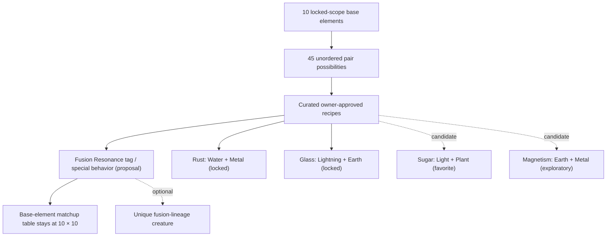

# Fusion architecture and concept conflict audit — design options

> **Historical audit / superseded decisions:** The owner subsequently locked Rust, Sugar and Earth + Metal → Magnetism, unlocked Glass, and selected ten base schools with fusion techniques rather than new schools. See [current owner decisions](fusion-roster-decisions-2026-11-18.md). This document remains a record of earlier alternatives, not the live lock roster.

**Status: Exploration only — no new gameplay approval, elemental lock, merge, or release.**  
**Verified game source:** `main` at `5a7d0438e46582e625fc101efb6aa0f9e637c55e`.  
**Starting Element HQ ref:** `element-hq-v1` at `abf423bba86d3bf12f14a60259f4d8c272e7ad3b`.  
**Scope:** Re-evaluate Rust and Glass *without undoing their owner locks*; investigate Sugar, Earth + Metal, and system complexity. This design exploration does not grant new owner acceptance.

[Ten-element roster and locks](../../README.md#locked-element-and-fusion-decisions) · [45-pair Atlas](../fusions/fusion-chart.md) · [Prior conflict register](aldervale-fusion-guide-v1.md#fusion-conflict-register) · [Source-bound Graphify receipt](https://github.com/vixttha/AlderVale-Pact-of-Ten/blob/graphify-snapshots/main/receipt.json)

## Decision boundary: what is locked and what is not

- **Locked recipes:** Water + Metal → Rust; Lightning + Earth → Glass. A lock means the named fusion recipe remains in the roster *under review*, not that its implementation, full-school status, skill kit, visual design, creature acquisition, or combat balance have been approved.
- **Favorite:** Light + Plant → Sugar. Not locked; complete its identity, role and counterplay before asking for acceptance.
- **Paused:** Fire + Earth → Magma. Remains paused. Other combinations are explored without silently reviving it.
- **Exploratory:** Earth + Metal → Magnetism/Lodestone, and all other candidate pairs. A concept can overlap a locked parent and still be studied; overlap is a review signal, not an automatic ban.
- **Roster boundary:** exactly ten proposed base elements — Fire, Water, Lightning, Frost, Wind, Earth, Light, Dark, Metal, Plant. **Time and Space are not elemental schools**. Chronos/Aetheris are legacy development identities, not authorized additions to the new system.

## Audit finding A — fifteen schools are not necessary

Ten base schools require a base attack-defense table of 10 × 10 = **100 directed cells including self-matchups**. Adding five new full schools would require 15 × 15 = **225 directed cells**, 125 more than the ten-school table. There are 45 unordered base-base pairs; adding five new combinable types would create 105 unordered type pairs, but **this does not imply 105 playable recipes**. A five-recipe selection is a content choice, not a mathematical necessity.

Current development source is different from the approved future design: `shared/elements.ts` still enumerates six starter, four rare including Chronos, and five old fusion IDs including Aetheris. `shared/creatures.ts` resolves five old recipes; its `ember+bramble → magma` and `chronos+verdigris → aetheris` combinations are **not instructions to restore them**. Existing `getElementMatchupMultiplier` handles self-matchups, oppositions and inherited fusion bonuses. The previous [fusion conflict register](aldervale-fusion-guide-v1.md#fusion-conflict-register) records related prototype conflicts (F-01–F-29).

### Four architecture options

| Option | How it works | Upside | Risk | Verdict |
| --- | --- | --- | --- | --- |
| A. 15 full schools | Rust, Glass, Sugar, etc. become independently typed attack/defense schools | Maximum type identity | 225 matchup cells, duplicated resistances, five extra spell/visual/balance families | **Do not choose yet** |
| B. 10 base schools + resonance tags | Attacks/defenses stay one of ten base types; a creature/spell gets a fusion recipe tag and special trait | Distinct fusion fantasy with fixed core matrix | Requires clear tags, triggers, and one cost | **Recommended prototype** |
| C. Field combo only | Two distinct allied base elements produce a temporary combined ability | Smallest species/save burden | May underdeliver on unique fusion creatures | Good alternative |
| D. Fusion creatures as separate lineages, but not schools | Eggs/discoveries can yield unique species with one base battle type and fusion traits | Creature collection payoff without type sprawl | More asset, egg, species and save work | Compatible with B, but not automatically approved |

**Suggested common mechanics for B + optional D (all proposed):**
1. Every playable wizard remains one of the ten base elements; a fused creature has a predetermined *combat anchor* among its two source elements (e.g. Rust=Metal, Glass=Earth, Sugar=Plant) used for normal damage and resistance. The fusion tag names unique tactical behavior but does not introduce a fifteenth type.
2. A recipe consumes **two eligible source affinities as prerequisites**, but does **not consume or permanently merge the parent's existing creatures by default**. Whether discovery produces a non-consumptive pact hatchling (D) or only a field technique (C) stays an owner choice.
3. No recursive fusion. No fusion-as-input recipe. No automatic combined damage multiplier or free extra action.
4. One actionable setup and payoff per fusion; familiar dispels, shields, durations and combat resources first. New persistent status types must justify their extra saved/network state.
5. The current duel state has teams and turns but **no grid coordinates or lane system**, so Magnet pull/push must mean a target swap, forced targeting or redirect in an initial prototype — **not invented tile movement**.
6. Show parent badges, fusion name, effect, duration, counter, and whether the action creates a creature or temporary effect *before* spending anything. Use shape and motion in addition to color.
7. The old Hatchery, field-pact proposal, and literal two-creature merge are **three incompatible acquisition models**; do not mix them in tooltips.

## Audit finding B — the locked fusions have strong logic but nontrivial limits

### Water + Metal → Rust — locked, gameplay undefined

- **Real process:** iron or steel exposed to moisture and oxygen undergoes corrosion. Water alone does not rust every metal. [OpenStax corrosion](https://openstax.org/books/chemistry-atoms-first-2e/pages/16-6-corrosion).
- **Visual identity:** matte flaking orange/brown corrosion spreading over existing metal shapes; powder, jagged holes and weakened rivets. Distinct from polished Glass and sticky Sugar.
- **Preferred verb:** **degrade**. Proposed two-step kit: `Expose` marks eligible armor for at most two turns; `Rust Break` consumes the mark for a modest defense reduction; `Rust Scale` could be a defensive shedding move, not its own element.
- **Role:** slow attrition / armor interaction, **not** an all-purpose poison or automatic win versus Metal.
- **Counters:** non-ferrous or protected surfaces, cleanse, and time-limited marks. Wizard armor must have explicit applicability; otherwise a universal corruption debuff becomes too strong.
- **Conflict:** if Rust breaks all equipment it collapses the defensive niche of ordinary Metal. It also overlaps Magnetism's metal-object targeting. Differentiate **Rust breaks down** versus **Magnetism repositions/redirections**.
- **Alternative parent use:** Water + Earth → Mud is stronger for sticky terrain; Water + Lightning → Hydrogen is stronger for a volatile gas setup; Metal + Plant → Ironwood is defensive. None supersedes the owner's Rust lock.

### Lightning + Earth → Glass — locked, not automatically the best *school*

- **Real process:** lightning can fuse silica-rich sand/rock into fulgurite, which commonly forms branching hollow glassy tubes; it is not a field of perfect clear crystal spikes. [National Park Service](https://www.nps.gov/articles/grsa-fulgurites.htm), [Oxford University Museum](https://oumnh.ox.ac.uk/fulgurites).
- **Visual identity:** thin sharp translucent panes, branching hollow conduits, fractured surfaces, rigid triangular or plate-like silhouettes, ringing shatter sound. Glass is **amorphous/non-crystalline**; sugar can be crystalline. [RSC Education](https://edu.rsc.org/analysis/do-you-really-know-what-glass-is/3008331.article).
- **Preferred verb:** **shape → shatter**. Proposed: `Glass Screen` creates one short-lived barrier; `Refract` redirects one designated attack if paid for; `Shatter` consumes the barrier for an offensive payoff. Avoid a free permanent reflection loop.
- **Role:** fragile setup / burst, precise cover and limited redirection.
- **Counters:** blunt hits, disruption before setup, limited barrier durability. No universal counter reflecting every element.
- **Conflict:** Light + Metal → Mirror and Water + Light → Refraction could give identical mechanics. Protect Glass's niche by giving it breakable structure, not ownership of every light effect.
- **Alternative parent use:** Lightning + Metal is physically stronger for *electromagnetism*; Earth + Metal is evocative for *lodestone*, Wind + Earth for sand, and Fire + Earth for Magma (paused). These are **proposals**, not replacements for Glass.

## Audit finding C — Sugar should be sticky energy storage, not transparent crystal damage

**Favorite, not locked.** Plants use light energy, water and atmospheric carbon dioxide to make carbohydrates. A magical plant creating an instant pile of large refined sucrose crystals is a *fantasy extension*, not the entire photosynthesis process. [Smithsonian](https://ssec.si.edu/node/915), [OpenStax biology](https://openstax.org/books/biology-2e/pages/8-1-overview-of-photosynthesis).

| Dimension | Proposed Sugar | Glass (locked comparator) |
| --- | --- | --- |
| Core verb | **bind / bank / release** | **shape / refract / shatter** |
| First visible state | Amber/gold translucent syrup ribbons and vine-bound droplets | Hard angular clear/smoky panels and hollow fulgurite tubes |
| Secondary state | Chunky rock-candy clusters or caramel shells, only after setup | Thin shards / fractured plates |
| Sound/motion | Sticky stretch, bubbling, slow snap | Metallic chime, brittle crack, instant break |
| Combat job | Restrict timing; bank one resource to spend later | Temporary barrier and one sharp payoff |
| Weakness | Water dissolves syrup; heat changes it; stored charge expires | Blunt fracture; limited panel integrity |
| Never | Another glass spear school / limitless healing | Permanent reflection / all-purpose fortification |

**Minimum Sugar kit to prototype (numbers illustrative, not accepted):** `Syrup Trail` occupies one enemy action window and applies a one-turn slow or target restriction; `Sun Store` banks a capped energy charge for a later action rather than giving an immediate extra attack; `Candy Lattice` consumes an existing syrup patch to trap once. Keep 1 active patch maximum, 1 stored charge maximum, and allow one normal counter. In a non-grid duel, translate a trail into a target debuff or delayed cast rather than pretending movement tiles exist.

Three Sugar directions to compare before locking: **A. Adhesive controller** (distinct but could overlap Mud/Tar); **B. Energy battery** (distinct if the charge is visible and capped, but risks snowball); **C. Crystal fortifier** (visually overlaps Glass; weaker). **A + a small amount of B** seems the clearest prototype. Do not grant unconditional heals simply because sugar is food.

## Audit finding D — Earth + Metal → Magnetism / Lodestone deserves a slot in exploration

The [current Earth + Metal pair page](../fusions/pairs/earth-metal.md) records Lodestone as a supporting material rather than an independent fusion. This **audit proposes** checking whether it can support a new fusion-style *behavior* without assigning a lock.

- **Real-world basis:** lodestone is naturally magnetized magnetite, a magnetic iron oxide found in rock; merely mixing arbitrary soil with arbitrary metal does not generate a magnet. [University of Minnesota mineral guide](https://commonminerals.esci.umn.edu/minerals/g-m/magnetite).
- **Name distinction:** `Magnet` is an object; `Lodestone` is a concrete mineral; `Magnetism` is the force or magic behavior. For a behavioral tag, **Magnetism** is more exact; for a grounded creature/material, **Lodestone** is more distinctive.
- **Proposed verbs:** **attract / anchor / redirect**. One `Polarize` mark, one `Draw` or `Repel` action affecting an eligible metal-tagged target, and `Compass Ward` that redirects one eligible physical hit.
- **No-grid translation:** retarget one metal-related attack, force an enemy creature switch if a legal switch exists, or modify guard/target priority; **do not implement tile-pull** without a positional combat system.
- **Counter:** nonmagnetic objects, insulated/nonmetal tools, mark cleanse, a limited activation count. Avoid controlling every opponent regardless of equipment.
- **Overlap:** shares Metal with Rust and Earth with Glass. All three can coexist *as studied concepts*; no-repeat is advisory. Rust degrades materials; Magnetism redirects eligible metal; Glass makes brittle structure. Magnetism should not instantly become a full separate weakness/resistance school.
- **Alternative parent logic:** Lightning + Metal → electromagnetism is more immediately causal because an electric current in conductive wire produces a magnetic field. Earth + Metal better evokes natural lodestone, rock bodies and geological resource identity. Owner preference between them is still open.

## Audit finding E — acquisition and permanence are separate choices

| Mechanic | Two existing creatures become one? | New persistent creature? | Complexity |
| --- | --- | --- | --- |
| Field spell combo | No; both remain available | No | Lowest |
| Pact encounter → egg | No; both remain separate | Yes, if earned | Moderate/high |
| Timed transformation | Temporary combined battle form; reverses | Usually no | Moderate/high |
| Irreversible merge | Yes; source creatures are consumed or replaced | Yes | Highest, destructive |

The historical prototype uses Hatchery egg progression. A later field-pact draft imagines a companion discovery encounter. Neither is accepted as the future design. The user does not need to commit to irreversible permanent merging, and creating new fused creatures does not mean two existing companions must be deleted. **Suggested demonstration:** start with a non-consumptive *field combo* that uses two base affinities, and decide later whether a successful encounter may produce a separate fusion-lineage egg. This demonstrates the verbs before adding a species roster and save burden.

## Audit finding F — 45 base pair explorations (not 45 eligible fusion schools)

**Classification is an editorial design judgment, not an owner rejection or a new lock.** The public Name Atlas retains all 320 earlier suggestions and their recorded statuses. This table expands one representative direction per pair; many are most appropriate as attacks, materials or field conditions.

| Pair | Best exploratory direction | Form | Mechanic / game role | Weak point |
| --- | --- | --- | --- | --- |
| Fire + Water | Steam | Technique / material | Hot vapor clouds; pressure release, sight blocking | Overlaps Water; no need for another school |
| Fire + Lightning | Plasma | Weak affinity candidate | High-energy arc and ignition burst | Lightning already forms conductive plasma; identity overlaps |
| Fire + Frost | Thermal Shock | Technique | Sudden temperature change fractures an existing defense | It's a reaction, not a substance |
| Fire + Wind | Fire Whirl | Technique | Wind concentrates or spreads existing flames | Just a Fire move without unique costs |
| Fire + Earth | Magma | Paused fusion | Molten terrain, slow siege pressure, cooling crust | Owner paused; shares Earth with locked Glass |
| Fire + Light | Flare | Technique | Brief burst that reveals hidden targets | Fire already emits light |
| Fire + Dark | Smoke | Exploratory fusion / field | Concealment, ash trails, choking zones | Needs material/combustion source; too close to a spell |
| Fire + Metal | Slag | Material / craft | Disrupt equipment, molten debris, forging | Metal subtype; not automatically a school |
| Fire + Plant | Ash / Tar | Two distinct candidate concepts | Ash marks terrain and smothers; Tar binds and seals | Strong design, but choose distinct mechanics; may overlap Sugar sticky control |
| Water + Lightning | Hydrogen | Parked fusion candidate | Electrolysis-derived gas; volatile setup and release | Electrolysis also yields oxygen; overlaps Water locked Rust |
| Water + Frost | Ice / Glacier | Material / terrain | Temporary blocking, preservation, slowing | Feels like Frost's existing toolkit |
| Water + Wind | Mist / Fog | Field effect | Obscuration, hydration, weather | Similar to Steam/Smoke without unique identity |
| Water + Earth | Mud / Clay | Material / field | Slow terrain, molding, cover | Overlaps Sugar adhesion and Earth barriers |
| Water + Light | Refraction | Technique | Optical lens, decoy, reveal | Glass already uses light bending; not a new substance |
| Water + Dark | Dark Water / Ink | Exploratory field | Opaque pools or concealment | No inherent dark liquid without pigment/magic |
| Water + Metal | Rust | LOCKED fusion | Gradual wear, armor damage setup, brittle payoff | Needs oxidizable metal plus oxygen; don't universally corrode every metal |
| Water + Plant | Growth / Sap | Technique / resource | Growth trigger, healing ingredient, harvest | Usually baseline Plant |
| Lightning + Frost | Static Rime | Technique | Charged freezing, risk-reward burst | Two status effects, not new affinity |
| Lightning + Wind | Ozone | Parked fusion candidate | Reactive atmospheric gas zone, area denial | Real atmosphere/oxygen required; toxic, not a healing gas |
| Lightning + Earth | Glass | LOCKED fusion | Brittle panes, shatter trap, refraction and piercing | Fulgurite is often sandy hollow glass, not flawless crystal towers |
| Lightning + Light | Radiant Arc | Technique | Dazzle / disruption through luminous discharge | Lightning already emits light |
| Lightning + Dark | Blackout | Technique / field | Disrupt vision, suppress visible effects | Effect depends on tech/lighting; not new substance |
| Lightning + Metal | Electromagnetism | Candidate interaction | Current creates field; metal redirects, attraction, defense | Physically strongest magnet mechanism, but Lightning already used in Glass |
| Lightning + Plant | Rubber | Material / fantasy rule | Insulation, spring/rebound, plant latex | Electricity alone does not vulcanize latex into rubber |
| Frost + Wind | Liquid Air / Ice Fog | Exploratory field | Cold air deposit, evaporating cloud, brief shelter | Liquid air requires extreme cooling; Dry Ice requires carbon dioxide |
| Frost + Earth | Permafrost | Terrain | Frozen soil cover, root denial | Excellent environment; not necessarily affinity |
| Frost + Light | Halo / Rime Lens | Optical technique | Ring effect, visibility or beam deflection | Overlap Glass optics and ordinary Frost |
| Frost + Dark | Black Ice | Terrain / stealth | Slippery trap with concealed hazard | Useful stealth ability, but no distinct elemental identity |
| Frost + Metal | Brittle Metal | Technique / modifier | Crack cold equipment, one-turn defense vulnerability | Mostly debuff of Metal |
| Frost + Plant | Dormancy | State / defense | Delay growth to store energy, preserve seeds | Can overlap Sugar energy storage |
| Wind + Earth | Sand / Dust | Field / material | Abrasive clouds, trails, erosion | Wind transports sand; erosion is gradual, not instant creation |
| Wind + Light | Mirage | Optical technique | Target misdirection | Needs light and gradients; risk of Glass duplication |
| Wind + Dark | Shroud | Technique | Moving concealment and false cues | Not a separate substance |
| Wind + Metal | Resonance / Chime | Exploratory fusion concept | Metal vibration, sonic interruption, timing | Needs sonic identity beyond Wind or Metal |
| Wind + Plant | Pollen / Thread | Material / field | Seed spread, tethering, visibility / tracking | Often Plant technique; Thread not automatically created by wind |
| Earth + Light | Phosphor | Parked material / concept | Minerals store and emit light for tracking | Needs specific chemistry/magic; Earth overlaps Glass |
| Earth + Dark | Cavern / Shade Ore | Habitat / material | Cover, stealth passages, hidden resources | A location/ore variation, not a new affinity |
| Earth + Metal | Lodestone / Magnetism | NEW exploratory concept | Attract, redirect, anchor metal-tagged effects | Natural magnetic ore is plausible; magnetism is a force, not a new element |
| Earth + Plant | Amber | Parked material concept | Preserve resin, seal clues, slow setup | Fossilized resin requires long geological process; Earth overlaps Glass |
| Light + Dark | Eclipse | Phenomenon / dual spell | Visibility timing, reveal vs conceal | Valid motif; not automatically a new elemental substance |
| Light + Metal | Mirror | Material / optical technique | Reflect or redirect one attack | Strong ability; overlaps Glass refraction |
| Light + Plant | Sugar | FAVORITE, NOT LOCKED | Sticky syrup, stored energy, hardened traps | Needs visual distinction from Glass and counterplay |
| Dark + Metal | Black Steel / Patina | Material / variant | Stealth-coated armor or concealing plate | Another metal subtype; owner dislikes this pattern |
| Dark + Plant | Ink | Exploratory candidate / material | Mark targets, obscure vision, create readable trails | Pigment source plausible; overlaps Smoke/Shroud concealment |
| Metal + Plant | Ironwood | Parked composite | Flexible structure, reinforced growth, defense | Depends on world metal rules and shared Metal parent |

## Portfolio analysis — do not force five equally important fusions

**No-repeat lineup if Sugar eventually wins:** Rust (Water+Metal), Glass (Lightning+Earth), Sugar (Light+Plant) leave Fire, Frost, Wind and Dark. The theoretical fill is *Fire+Dark* (Smoke) plus *Frost+Wind* (cold-air deposit), or *Fire+Frost* (Thermal Shock) plus *Wind+Dark* (Shroud). These are **mechanically weaker as new affinities**, so the game should not force them into full elements just to reach five names.

**Strong alternative concepts even with parent overlap:** Earth+Metal Magnetism, Fire+Plant Tar, Lightning+Wind Ozone, Water+Earth Mud, Wind+Metal Resonance, Earth+Plant Amber. Their value is measured by distinct gameplay, not parental exclusivity. Magnetism is the strongest new movement/control *idea*, but depends on battle targeting and material tags.

**Suggested design portfolio:** 2 locked recipes documented; 1 favorite Sugar to prototype; Magnetism and Tar/Ash to compare; the remaining 45 pair catalog stays open. No declaration that exactly five must become playable.

## Source and implementation conflict watchlist

| ID | Finding / regression risk | Needed proof before gameplay |
| --- | --- | --- |
| FA-01 | Main's legacy 15 IDs and five old recipes conflict with the owner's 10-base roster and new locks | Separate migration/design candidate with exact test checkout and no silent restoration of Chronos/Aetheris |
| FA-02 | Same word *fusion* means creature lineage and in-hand spell enchantment in existing records | Different UI labels and data types; separate acceptance |
| FA-03 | Sugar crystal attacks overlap Glass visuals | Art silhouette/readability mock, no-color mode, ability verb check |
| FA-04 | Sugar sticky terrain overlaps Mud/Tar; energy banking overlaps ordinary Plant/Light | Select one primary role, specify counters and caps |
| FA-05 | Rust requires oxidizable metal and oxygen; generic Metal is broader | Clear eligible target/material tagging and independent metal defense role |
| FA-06 | Magnetism overlaps Rust and Glass's metal/earth parents; Lightning+Metal is alternate logic | Compare actual role utility and whether overlap is acceptable, without changing locks |
| FA-07 | No grid coordinates/lane abstraction on current duel state; position-based Magnet abilities wouldn't execute | Implement existing target/guard redirection *or* separately approve grid design |
| FA-08 | Legacy fusion status yields 15×15 matchup burden and 225 cells | Choose secondary tag or explicitly accept new schools before rewriting matrix |
| FA-09 | Main's existing Hatchery grants and field-pact proposal have incompatible recipe, cost and claim lifecycles | One acquisition model, explicit previews, no silent parent consumption, consistent guest/cloud save |
| FA-10 | Legacy `resolveFusionSpecies` may return null/fallback for new pairs | No phantom offspring, stable species ID, idempotent claim and recoverable egg |
| FA-11 | Fusion states could create new damage, status, shield, and multiplayer discrepancies | One bounded mechanic prototype; deterministic same action client/server, public runner tests |
| FA-12 | Science is inspiration, not sufficient lore: a natural mineral or chemical product doesn't automatically make a compelling school | Require independent mechanics and distinguish where fantasy begins |
| FA-13 | [Draft PR #130](https://github.com/vixttha/AlderVale-Pact-of-Ten/pull/130) currently prototypes a Magma pact even though Magma is paused in the owner-directed design | Keep draft/implementation evidence separate; do not merge, promote, or infer a new Magma acceptance from an in-flight prototype |
| FA-14 | [Draft PR #120](https://github.com/vixttha/AlderVale-Pact-of-Ten/pull/120) captures a legacy combat baseline, not the new ten-element design | Treat its tests as old-behavior evidence only; do not make them acceptance for a 15-school redesign |

The previous HQ conflict register F-01–F-29 remains intact; these FA- items are a **supplement**, not an assertion that the older issues were fixed or closed.

## Validation plan — only after owner chooses an architecture

1. Validate ten base element IDs and five opposition pairs in a standalone design test fixture.
2. Verify Rust/Glass lock preservation, Sugar favorite status, Magma paused, and time/space not in the roster.
3. Confirm the fusion trait does not introduce new matchup cells under proposed option B, using deterministic fixtures.
4. Verify an enemy has at most one Glass barrier, one Rust mark group, one Sugar active patch, and one Magnet focus per proposed test rules.
5. Confirm Sugar and Glass silhouettes read without hue, zoom and effects; confirm each has a unique gameplay verb.
6. If choosing pact eggs: run exact-claim, save-failure/retry, source-parent retention, duplicate-submit, guest/cloud persistence, and removed-species recovery checks.
7. Run relevant TS/Vitest, browser and Firestore-emulator tests on standard public GitHub-hosted runners at the actual implementation SHA. No gameplay implementation or runner-heavy game suite is authorized by this design memo alone.

## Graphify scope and evidence

The existing Graphify code snapshot at `graphify-snapshots`, `main/receipt.json`, is already tied to exact main source `5a7d0438e46582e625fc101efb6aa0f9e637c55e`, Graphify `0.9.109`, graph SHA-256 `d533a0e6a3d35e7fb90f6c2e6cb500d80fba5a240df42cb62ca89451b98483d7`, 1,292 nodes and 2,977 edges, with MCP snapshot verification reported by its public runner. This confirms a **code dependency graph**, not an approved fusion gameplay graph or a design playtest. Source records and this audit identify the existing game/code conflicts; no new design mechanics were executed.

## Outstanding owner decision points (none assumed)

- Are fusion results full damage types, source-element tags on special abilities, temporary field combos, or an optional creature lineage after discovery?
- For Sugar, should the emphasis be *sticky terrain and stored light energy* rather than giant crystals?
- For Earth + Metal, is the fantasy **Magnetism** (force) or **Lodestone** (material) compelling enough alongside the two existing locks?
- Is five the desired eventual number of fusion discoveries, or can the roster stop at the number of genuinely distinct ideas?
- Should a new companion be created without consuming parents, or should fusion be exclusively a temporary cooperative move?

Until these receive explicit answers, do not extend the type matrix, modify the lock roster, or claim gameplay acceptance.
