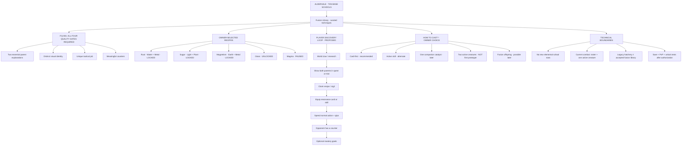

# Fusion System Mind Map — Law, Discovery, Combat, Creatures

**Status:** planning graph; branch-only rule is owner confirmed, interaction branches are proposals.  
**Verified `main`:** `5a7d0438e46582e625fc101efb6aa0f9e637c55e` · **Design baseline:** `d3c3683cb335bea77952b711f4e95cc6b1030b92`

[Quality law](../FUSION_QUALITY_LAW.md) · [Full system choices](fusion-system-revamp-proposal.md) · [Live recipe decisions](fusion-roster-decisions-2026-11-18.md)

## One-screen branch map

- **Locked law:** a fusion must pass the parent, visual, gameplay and counterplay gates before becoming playable.
- **Locked recipes:** Rust, Sugar and Magnetism. The recipe choices are not confirmations that combat and art specifications have passed every gate.
- **Live school boundary:** exactly ten base elemental schools; fusion tags/techniques do not add matchup matrix types.
- **Recommended gameplay:** discovery quest, one-time Fusion Library unlock, optional deck card, normal action and pip cost, readable enemy counter.
- **Creature questions:** ownership of two parent creatures may be part of discovery, but both creatures need not be active in combat; fused offspring is deferred.
- **Current gaps:** save model for recipe unlock, card/skill choice, trigger, target/cost/counter, progression rewards, and compatibility with existing Hatchery and in-hand enchant.

The graph records options and dependencies; it does not claim these mechanics already exist in the game.
