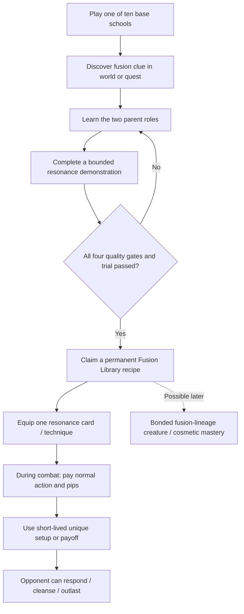

# Fusion Library revamp — playable-system design choices

**Status:** Proposed design, not owner-accepted mechanics. The [Fusion Quality Law FQ-001](../FUSION_QUALITY_LAW.md) is owner-approved; this document explores how to satisfy it.  
**Game source read:** `main` at `5a7d0438e46582e625fc101efb6aa0f9e637c55e`. **Design starting ref:** `element-hq-v1` at `d3c3683cb335bea77952b711f4e95cc6b1030b92`.  
**Decisions preserved:** ten base elemental schools; fusion **techniques** (not new schools); selected recipe names Rust, Sugar, Magnetism; Glass reopened; Magma paused; optional collectible fusion creatures only later.

## What a fusion is — confirmed boundary versus open mechanism

A resonance is a named technique discovered through two parent elements. Its spells can be represented as **cards or activated skills**, without introducing new `ElementId` school types, an eleventh damage affinity, or a 15×15 matchup matrix. This architectural direction is accepted; its exact unlock, UI, cost, spell ownership and companion requirements are **not yet decided**. The legacy game already has a 15-ID prototype in [elements.ts](https://github.com/vixttha/AlderVale-Pact-of-Ten/blob/5a7d0438e46582e625fc101efb6aa0f9e637c55e/shared/elements.ts), which must be reconciled in a separately authorized implementation.

## How a player might discover, earn and use a fusion (recommendation, not locked)

**Suggested player milestone loop (open):** 
1. **Rumor / clue:** see a material result or environmental event. The Fusion Library shows an unknown recipe silhouette, without spoiling every secret.
2. **Proof of understanding:** expose what each parent does during a short quest, duo-encounter or guided demonstration. Eligible inputs could be **two owned compatible companions** or quest-provided trial helpers for solo accessibility; this is an explicit choice.
3. **Resonance challenge:** demonstrate setup and counterplay, then earn a **one-time recipe unlock**. Do not silently remove source creatures or grant repeatable rewards for duplicate submissions.
4. **Equipment:** equip a resonance card or action from the Library. The selected technique **costs an action and a bounded pip/resource cost**; no extra free turn, automatic always-on damage multiplier, or universal new school.
5. **Mastery goals:** choose optional achievements for a separate visual sigil, a new behavior branch, or creature-lore encounter. Avoid grinding solely for higher damage or requiring any cash purchase.
6. **Creature collection later:** a non-destructive fusion-lineage creature or egg could be a separate reward stream **only if explicitly approved**; the recipe unlock is not itself an egg.

## Where does it live in the product?

| Surface | Proposed role | Current source or blocker |
| --- | --- | --- |
| **Fusion Library** (world journal / deck workshop) | Browse clues, discover recipes, see two-parent diagram, compare Q1–Q4, equip learned technique | New UI concept; not an existing implemented screen |
| **Player deck / hand** | The first prototype could be a fusion **card** with parent badges and a single normal combat action / cost | [Spell definitions, pips, unlocks](https://github.com/vixttha/AlderVale-Pact-of-Ten/blob/5a7d0438e46582e625fc101efb6aa0f9e637c55e/shared/spells.ts) and [combat hand/deck](https://github.com/vixttha/AlderVale-Pact-of-Ten/blob/5a7d0438e46582e625fc101efb6aa0f9e637c55e/shared/combat.ts) already exist |
| **Creature collection / Hatchery** | Optional discovery prerequisite, companion catalyst, or **future** fusion-offspring acquisition | [Arbor currently uses old fixed `resolveFusionSpecies` eggs](https://github.com/vixttha/AlderVale-Pact-of-Ten/blob/5a7d0438e46582e625fc101efb6aa0f9e637c55e/src/features/creatures/CreaturesArborPanel.tsx); not new system |
| **Combat HUD** | Show fusion name, cost, target eligibility, temporary effect, expiry and counterplay visibly | Existing combat is turn/team/card oriented, not a positional grid |
| **Progression** | Store unique recipe unlock and optional mastery separate from primary school identity | Current `unlockedFusions` references old `ElementId` types; requires a new, separately authorized data design |
| **PvP / co-op** | Use identical server-authoritative targeting, duration and cost rules; prevent unbounded chains | Existing multiplayer selectors and save permissions need their own validation once implemented |

## How many creatures are needed?

| Model | Requirement | Benefits | Difficulty | Current verdict |
| --- | --- | --- | --- | --- |
| A. **Card-first discovery** | No dual creature requirement after recipe earned; a quest demonstrates the parents | Lowest combat complexity; integrates with decks and pips | Requires new recipe unlock record and UI | **Recommended prototype** |
| B. **Two owned creature sources at discovery** | Two compatible creatures in roster for a one-time ritual or trial; not simultaneously active | Rewards bonding and collection without turning each battle into a roster puzzle | Must handle ownership, solo accessibility, persistence and retries | Worth comparing |
| C. **Companion-triggered technique** | One equipped companion enables or strengthens the move | Companion identity is meaningful | Needs a clear action economy, eligibility, creature branch/persistence and PvP rule | Later option |
| D. **Two simultaneously active creatures** | Both source creatures must fight together for fusion cast | Strong duo fantasy | Current [combatant](https://github.com/vixttha/AlderVale-Pact-of-Ten/blob/5a7d0438e46582e625fc101efb6aa0f9e637c55e/shared/combat.ts) has a roster and **one** `activeCreatureIdx`; dual-active casting requires redesign | **Not recommended for first prototype** |
| E. **Fusion-offspring egg** | Two source lineages create a unique new creature; parents remain | Long-term collectable goal and creature identity | New species, art, hatching, cloud/guest save, reconciliation of old eggs | Separate future decision |

**Most coherent initial proposal:** a player unlocks a recipe after a trial, equips a resonance **card**, and uses it by spending normal pips/action. A companion can be relevant during discovery, but **two creatures need not be active in the battle**. This is an open prototype choice—not an owner's accepted mechanic.

## How do fusion cards avoid becoming a new school?

The technique has a **recipe ID** (e.g. `rust`) separate from its **ordinary base damage school**. For a proposed first pass, each technique could select a stable base anchor rather than calculating another school:
- Rust: Metal-anchored damage/status proposal; Water is a prerequisite and thematic source.
- Sugar: Plant-anchored effect proposal; Light is the energy source.
- Magnetism: Earth-anchored control proposal; Metal supplies the eligible magnetic material.

These anchor choices are **not accepted**; a two-parent composite action is also possible. Whatever the choice, combat still resolves using the normal ten base affinities, without introducing a new matchup row/column for the fusion name. The fusion label is **not** an excuse to bypass resistances. Keep costs, targets and counters explicit.

## Quality-law worked examples (draft kit, not final specs)

| Locked recipe | Parent contribution | Unique tactical job | Possible visual | Counterplay to prove | Unresolved dependencies |
| --- | --- | --- | --- | --- | --- |
| **Rust** | Water promotes corrosion of eligible Metal surfaces in an oxygen-compatible world rule | Gradual eligible-defense degradation, with capped payoff | Flaking matte oxides and pitted armor, not generic poison | Cleanse, protected/non-reactive targets, short expiry | Distinguish non-metal and magically shielded targets; exact damage/cost |
| **Sugar** | Plant makes sugar using Light; instant battlefield forms are magical | Sticky setup, stored energy and/or crystal-shard payoff without copying Frost | Syrup arcs, sparkling amber candy lattices, fractured crystalline projectiles | Dissolution, breaking crystals, limited stored charges and duration | Choose whether crystal shards, adhesive control or energy banking is primary |
| **Magnetism** | Earth hosts naturally magnetic minerals; Metal provides a susceptible target/conductor | Redirect or anchor eligible metal-related actions | Dark lodestone orbits, directional force arcs, metallic fragments | Nonmagnetic targets, cleanse/interrupt, capped retarget | No tile grid; define target eligibility and prevention of universal redirects |

Passing the law requires actual Q1–Q4 evidence **for the particular playable kit**, not merely a convincing name.

## Conflict ledger and unresolved architecture questions

| Conflict | Verified present state | Required future decision or evidence |
| --- | --- | --- |
| **Legacy schools and creature recipes** | Current development code has six starter, four rare including Chronos, five fusion IDs, five hardcoded recipes | Migrate separately; don't treat old Magma/Tempest/Eclipse/Aetheris behavior as current design acceptance |
| **Term 'fusion' also used for Keen Ink enchant** | [`shared/spells.ts`](https://github.com/vixttha/AlderVale-Pact-of-Ten/blob/5a7d0438e46582e625fc101efb6aa0f9e637c55e/shared/spells.ts) uses in-hand fusion for an enchant | Rename the distinct UI concepts; don't conflate enhancer with resonance unlock |
| **Two active creatures** | Combat uses a roster and one active index | Either avoid dual-active prerequisite or explicitly redesign turn state, UI, and PvP |
| **Hatchery grants vs technique unlock** | Existing egg progression and `unlockedFusions` tie to old species/element catalog | Separate recipe mastery from species ownership and prevent duplicate claims |
| **Owner paused Magma** | A separate [draft PR #130](https://github.com/vixttha/AlderVale-Pact-of-Ten/pull/130) prototypes a Magma companion pact | No implied owner acceptance, merge or new design requirement |
| **First playable milestone** | Current private milestone is guest-first-playable, not new fusion feature work | **Milestone fit unverified** for gameplay implementation; this document is design-only |

## Explicit owner choices still open

1. Should unlocking involve **two owned companion elements**, or a quest that can lend temporary elemental partners to solo players?
2. Is the first playable expression **a normal card in deck**, **a dedicated activated ability**, or **a companion action**? Suggested: one card with a normal action and pip cost.
3. Are recipes **per wizard**, **per account**, or **per creature**? How do guest saves, cloud saves and realm boundaries behave?
4. Should fusion use just one base anchor for combat, or include **both parents' actions sequentially** within a single turn? Do not invent double damage or free turns.
5. Where do candidates fail Q1–Q4, and which milestones feel rewarding without becoming power inflation?
6. What is the minimum demonstration that shows the player how to counter Rust, Sugar or Magnetism before they use it in PvP?

**No source edits, data migrations, gameplay features, merges, or releases are authorized by this proposal.** When the owner chooses the form, create a separately scoped implementation issue/PR, then run exact-checkout public GitHub-hosted CI.

[Quality law](../FUSION_QUALITY_LAW.md) · [Mind map](fusion-system-mind-map.md) · [Current roster](fusion-roster-decisions-2026-11-18.md)
