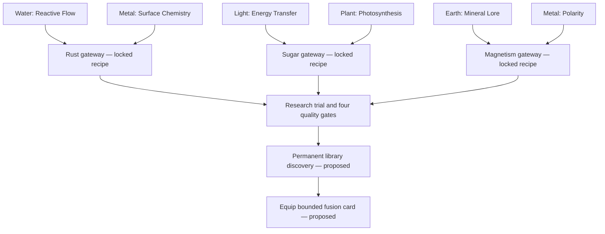

# Skill tree feasibility: ten elemental masteries and shared fusion bridges

**Status: EXPLORATORY — NO NEW OWNER LOCKS.** This is a reviewable design chart, not authorized gameplay implementation. Existing [Fusion Quality Law FQ-001](../FUSION_QUALITY_LAW.md) still governs every future playable fusion.  
**Verified gameplay main:** `5a7d0438e46582e625fc101efb6aa0f9e637c55e`. **Design starting ref:** `bdfaafca9ab2dff49e49a3a6c21fe20d8f8520f4`.

## Core proposal and decision boundary

AlderVale keeps **ten elemental schools** and a **curated Fusion Library**. Small skill trees help players specialize and understand how an element works. A skill-tree **gateway** joins two parent trees in a single canonical fusion recipe. This does not create a school, additional creature, card, or skill automatically. Parent reuse is permitted. The 45 unordered base-element pairs appear as **90 mirrored endpoints** across ten views, but none is promised playable on visibility alone.

**Confirmed recipe selections:** Water + Metal → **Rust**, Light + Plant → **Sugar**, Earth + Metal → **Magnetism**. **Glass** is unlocked/exploratory; **Magma** paused. The locked recipe names are not final kits; they still need the four gameplay-quality gates.

## Ten tree charts

| Element | Proposed opening | Three learning themes | Partner gateways |
| --- | --- | --- | ---: |
| [Fire](skill-trees/fire.md) | Thermal Attunement | Ignition · Heat Shaping · Residue | 9 |
| [Water](skill-trees/water.md) | Flow Attunement | Pressure · Purification · Reactive Flow | 9 |
| [Lightning](skill-trees/lightning.md) | Charge Attunement | Arc Routing · Charge Storage · Ionization | 9 |
| [Frost](skill-trees/frost.md) | Cold Attunement | Preservation · Phase Control · Thermal Stress | 9 |
| [Wind](skill-trees/wind.md) | Current Attunement | Air Pressure · Dispersal · Aerial Rhythm | 9 |
| [Earth](skill-trees/earth.md) | Mineral Attunement | Stone Form · Mineral Lore · Grounding | 9 |
| [Light](skill-trees/light.md) | Radiant Attunement | Illumination · Energy Transfer · Refraction | 9 |
| [Dark](skill-trees/dark.md) | Shadow Attunement | Concealment · Weakening · Night Signals | 9 |
| [Metal](skill-trees/metal.md) | Forge Attunement | Alloycraft · Surface Chemistry · Polarity | 9 |
| [Plant](skill-trees/plant.md) | Growth Attunement | Roots & Vines · Photosynthesis · Sap & Fibers | 9 |

All charts are conceptual; do not confuse each lane's learning theme with an owner-approved spell, node count, cost, or combat bonus.

## How two trees meet at a fusion

**Do not automatically unlock a fusion by clicking two nodes.** A branch helps explain both parents. A meaningful exploration/trial unlock would reward the discovery; a card/skill can be one normal combat action at an ordinary cost. This is only a proposal. Two simultaneous active creatures are *not* assumed.

## Is a skill tree worth it?

| Alternative | Subjective design fit | Advantages | Costs |
| --- | ---: | --- | --- |
| Ten enormous talent forests | 5/10 | Countless long-term builds | Filler nodes, overwhelming UI, high balance and maintenance burden |
| Discovery quests and Fusion Library only | 8/10 | Clear goals, simple onboarding | Limited per-school customization |
| **Compact mastery trees + discovery library** | **9/10** | Specialized builds and rewarding cross-school milestones | Must separate points from discovery and avoid duplicate progression |

**Recommended experiment:** prototype **Water**, **Metal**, and **Rust** on paper first, compare against the quest-only alternative, then decide whether the points genuinely add fun. Do **not** build all ten gameplay trees at once.

## Existing level, XP and rank facts

The current [wizard XP function](https://github.com/vixttha/AlderVale-Pact-of-Ten/blob/5a7d0438e46582e625fc101efb6aa0f9e637c55e/shared/quests.ts) stops leveling at **level 50**. [Realm formulas](https://github.com/vixttha/AlderVale-Pact-of-Ten/blob/5a7d0438e46582e625fc101efb6aa0f9e637c55e/shared/realms.ts) calculate each next-level requirement as **90 + 45 × current level + 12 × current level² XP**, and cap ranks at **20**; different realms multiply earned XP at **3.5×, 1.75×, or 1.0×**. The [wizard progression document](https://github.com/vixttha/AlderVale-Pact-of-Ten/blob/5a7d0438e46582e625fc101efb6aa0f9e637c55e/shared/economy.ts) has no mastery-point pool today. Spellwrighting, shard upgrades, creature bond XP, and term rewards already exist.

| **Hypothetical point model** | Budget by level 50 | Pros | Cons |
| --- | --- | --- | --- |
| 1 point per level-up | 49 post-start points | Frequent feedback | Many filler nodes and capped choices |
| **1 point per two levels (even levels)** | **25 points** | Small predictable budget | A fast-XP realm unlocks power earlier in real time |
| One point per mastery quest | Variable | Discovery-oriented | Yet another independent grind |
| **Hybrid to test** | **25 level-derived mastery points + separate permanent recipe discoveries** | Clear split: character build vs achievements | Needs more UI and server save rules |

**Level points vs fusion:** Leveling could provide flexible allocation; mastering a parent school might make a *research quest* accessible, but recipes should be earned by distinct demonstrations rather than bought twice with points. Free respec outside battle is worth evaluating, and **earned recipe knowledge should survive respec**. Whether a respec temporarily changes which fusion cards can be equipped remains undecided.

### Illustrative progression curve, not owner acceptance

| Level | Proposed learning / reward | Risk |
| --- | --- | --- |
| 1–5 | Learn primary school, first branch | Preserve clear beginner play |
| 6–10 | Introduce a second school's basics | Do not force a school change |
| 11–15 | Optional first two-parent research trial | Do not guarantee every character a premature fusion |
| 16–25 | More controlled specialization and multiple curated discoveries | Avoid power creep and unbounded stacking |
| 26–50 | Lore, mastery variants, appearance rewards, difficult optional trials | No mandatory endless XP tracks |

The **point schedule and level bands are illustrative**. The player may have ten trees available without needing to max ten trees. An expensive unlock prerequisite in both parents **plus** a special quest **plus** two owned creatures would likely be too much.

## Would race perks interact with skill trees?

Verified [race definitions](https://github.com/vixttha/AlderVale-Pact-of-Ten/blob/5a7d0438e46582e625fc101efb6aa0f9e637c55e/shared/wardrobe.ts) already define **13 playable races** with affinity labels and passives. Verified [combat](https://github.com/vixttha/AlderVale-Pact-of-Ten/blob/5a7d0438e46582e625fc101efb6aa0f9e637c55e/shared/combat.ts) already applies some racial **health, power, accuracy and pierce** bonuses. Adding extra elemental skill points, exclusive fusions, free damage buffs, or locked racial trees could double-reward certain races and damage competitive fairness.

**Preferred non-power flavor, open for approval:** each race sees a distinct clue or art/lore path but **all races can master any element and unlock any accepted fusion**.

| Race | Example cosmetic/lore focus, never an exclusive node |
| --- | --- |
| Alder Human | Cross-school academy clues |
| Stoneborn | Mineral history and lodestone markings |
| Sky-Avian | Wind-current navigation |
| Cloud-Mist Sylph | Lightning-cloud observations |
| Woodland Dryad | Plant growth and photosynthesis |
| High Elf | Light scripts and illuminated manuscripts |
| Tideborn Siren | Water pressure and tides |
| River Naiad | Frost and water transitions |
| Beastfolk Clan | Clan stories and companion clues |
| Runeforge Dwarf | Forge sketches and metallic materials |
| Dark Elf | Veils, shadows and coded inscriptions |
| Draconic Kin | Heat, embers and thermal clues |
| Astral / Rift Kin | Arcane-puzzle variants without making Time/Space into schools |

These examples are **not confirmed racial perks**, nor a declaration that existing race bonuses are balanced.

## What implementation would change?

| Existing source-backed feature | Proposed change and additional testing |
| --- | --- |
| `level`, `xp`, `rank`, currencies and wizard progression | New authoritative point budget, purchased nodes, respec, race neutrality, duplicate-claim and save/reload tests |
| Spell cards, pips, one action, Spellwrighting | School-based technique modification, clear paid action, legal cards and status interaction tests |
| Current `ElementId` 6 starter / 4 rare / 5 fusion ids | Separate migration to the accepted ten-school schema before any skill-tree damage-typing assumption |
| `unlockedFusions` and old fixed hatchery eggs | Keep skill nodes, recipe knowledge, species ownership, and in-hand enchant effects as distinct records |
| Creature bonds and race passives | Avoid stacking passives and exclusive access; test 13 race builds and companion options |
| PvP, matchmaking, Firestore and guest persistence | Server-authoritative allocations, disallowed casts, respec restrictions, guest→account transitions and rollback |
| Existing responsive world, wizard studio and duel HUD | Ten usable diagrams, 90 mirrored links, keyboard/screen-reader support and readable no-color-only states |
| Standard public GitHub CI / Test Vault | Unit tests for point arithmetic, gateways, 45 canonical pairs and saved state, then Chromium/Firefox/WebKit flows |

**Graphify source reference:** [verified code-only main receipt](https://github.com/vixttha/AlderVale-Pact-of-Ten/blob/graphify-snapshots/main/receipt.json) at main SHA `5a7d0438e46582e625fc101efb6aa0f9e637c55e` reports 1,292 code nodes and 2,977 edges. It maps current source only, not the proposed mastery trees.

## Costs and remaining decisions

1. **Do points improve meaningful tactics, or merely duplicate existing Spellwrighting?** Compare a point-based Water + Metal → Rust route against a no-point quest unlock.
2. **How many schools may a wizard specialize in?** Avoid forcing permanent primary-school choices, especially when recipes reuse Metal.
3. **What earns a recipe?** Mastery threshold + quest demonstration is promising; dual active creatures and mandatory egg hatching are not required by this proposal.
4. **What does a race add?** Prefer optional thematic clues/cosmetics until competitive race balance and old affinities are reconciled.
5. **How do respecs, unlocks and server security work?** Record permanent discovery separately from changeable allocations, with an auditable grant and no duplication.
6. **Do the 45 research gateways stay visible from the start?** Consider hiding names until discovered while leaving accessible information and progress guidance.

**Overall assessment:** Worth **design prototyping**, not worth approving a full ten-tree gameplay build before the level/point economy, role of races and fusion activation are confirmed. **Milestone fit unverified** for gameplay implementation under the guest-first-playable milestone.

[Law](../FUSION_QUALITY_LAW.md) · [Existing Fusion Library proposal](fusion-system-revamp-proposal.md) · [First individual chart](skill-trees/fire.md).
