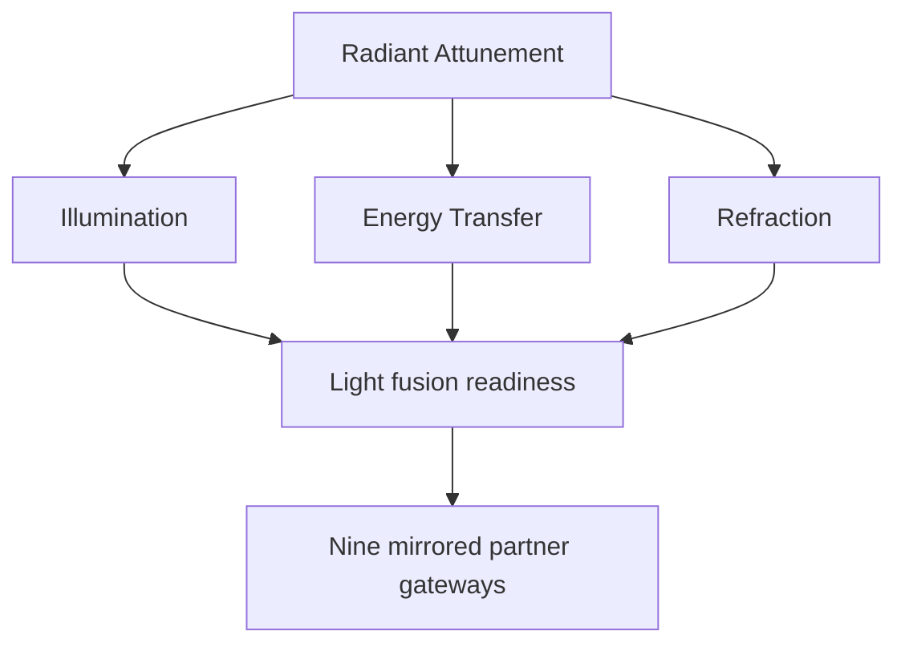

# Light — exploratory mastery tree

**NOT LOCKED / NO GAMEPLAY IMPLEMENTED.** The three tracks are conceptual themes, not accepted cards or stat bonuses.

[Skill-tree design feasibility](../skill-tree-feasibility-2026-11-18.md) · [FQ-001 law](../../FUSION_QUALITY_LAW.md) · [45-pair Atlas](../../fusions/fusion-chart.md)

## Light mastery chart

| Illustrative learning branch | Possible tactical or research purpose |
| --- | --- |
| Illumination | Reveal and mark |
| Energy Transfer | Short-lived stored energy |
| Refraction | Split or redirect light |

**Important:** readiness means the tree is able to explore a cross-school recipe. It does not automatically award the technique, require both companion creatures in battle, add a new school, or bypass the four quality gates.

## Nine partner gateways

Each row links to **one existing canonical pair page**, mirrored in the other school chart. Open/paused/blank entries are research possibilities, not approved playable fusions.

| Cross-school gateway | Atlas lead concept | Existing Atlas status | Partner mirror |
| --- | --- | --- | --- |
| [Light + Fire](../../fusions/pairs/fire-light.md) | Name not yet accepted | No distinct fusion candidate | [Fire tree](fire.md) |
| [Light + Water](../../fusions/pairs/water-light.md) | Name not yet accepted | No distinct fusion candidate | [Water tree](water.md) |
| [Light + Lightning](../../fusions/pairs/lightning-light.md) | Name not yet accepted | No distinct fusion candidate | [Lightning tree](lightning.md) |
| [Light + Frost](../../fusions/pairs/frost-light.md) | Name not yet accepted | No distinct fusion candidate | [Frost tree](frost.md) |
| [Light + Wind](../../fusions/pairs/wind-light.md) | Name not yet accepted | No distinct fusion candidate | [Wind tree](wind.md) |
| [Light + Earth](../../fusions/pairs/earth-light.md) | Phosphor | Paused / parked | [Earth tree](earth.md) |
| [Light + Dark](../../fusions/pairs/light-dark.md) | Name not yet accepted | No distinct fusion candidate | [Dark tree](dark.md) |
| [Light + Metal](../../fusions/pairs/light-metal.md) | Name not yet accepted | No distinct fusion candidate | [Metal tree](metal.md) |
| [Light + Plant](../../fusions/pairs/light-plant.md) | Sugar | Locked | [Plant tree](plant.md) |

## Possible progression (under review)

Learn a foundation → choose one learning lane → investigate the other parent's contribution → complete an optional discovery trial → gain a permanent Fusion Library record only if the particular technique is owner-accepted under FQ-001.

Wizard points, levels, school switching, race clues, trial costs, and recipe equipment limits are **open**, not implemented or approved. Racial choices must not block any gateway.
