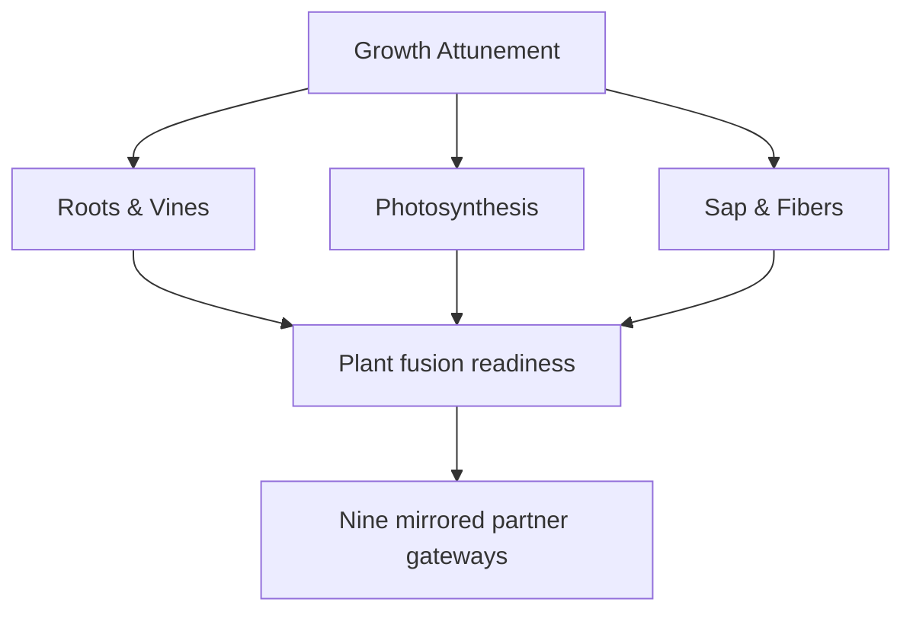

# Plant — exploratory mastery tree

**NOT LOCKED / NO GAMEPLAY IMPLEMENTED.** The three tracks are conceptual themes, not accepted cards or stat bonuses.

[Skill-tree design feasibility](../skill-tree-feasibility-2026-11-18.md) · [FQ-001 law](../../FUSION_QUALITY_LAW.md) · [45-pair Atlas](../../fusions/fusion-chart.md)

## Plant mastery chart

| Illustrative learning branch | Possible tactical or research purpose |
| --- | --- |
| Roots & Vines | Bind and support |
| Photosynthesis | Capture light as sugar |
| Sap & Fibers | Adhesion and structure |

**Important:** readiness means the tree is able to explore a cross-school recipe. It does not automatically award the technique, require both companion creatures in battle, add a new school, or bypass the four quality gates.

## Nine partner gateways

Each row links to **one existing canonical pair page**, mirrored in the other school chart. Open/paused/blank entries are research possibilities, not approved playable fusions.

| Cross-school gateway | Atlas lead concept | Existing Atlas status | Partner mirror |
| --- | --- | --- | --- |
| [Plant + Fire](../../fusions/pairs/fire-plant.md) | Ash | Open for review | [Fire tree](fire.md) |
| [Plant + Water](../../fusions/pairs/water-plant.md) | Name not yet accepted | No distinct fusion candidate | [Water tree](water.md) |
| [Plant + Lightning](../../fusions/pairs/lightning-plant.md) | Name not yet accepted | No distinct fusion candidate | [Lightning tree](lightning.md) |
| [Plant + Frost](../../fusions/pairs/frost-plant.md) | Name not yet accepted | No distinct fusion candidate | [Frost tree](frost.md) |
| [Plant + Wind](../../fusions/pairs/wind-plant.md) | Name not yet accepted | No distinct fusion candidate | [Wind tree](wind.md) |
| [Plant + Earth](../../fusions/pairs/earth-plant.md) | Amber | Paused / parked | [Earth tree](earth.md) |
| [Plant + Light](../../fusions/pairs/light-plant.md) | Sugar | Locked | [Light tree](light.md) |
| [Plant + Dark](../../fusions/pairs/dark-plant.md) | Ink | Open for review | [Dark tree](dark.md) |
| [Plant + Metal](../../fusions/pairs/metal-plant.md) | Ironwood | Paused / parked | [Metal tree](metal.md) |

## Possible progression (under review)

Learn a foundation → choose one learning lane → investigate the other parent's contribution → complete an optional discovery trial → gain a permanent Fusion Library record only if the particular technique is owner-accepted under FQ-001.

Wizard points, levels, school switching, race clues, trial costs, and recipe equipment limits are **open**, not implemented or approved. Racial choices must not block any gateway.
