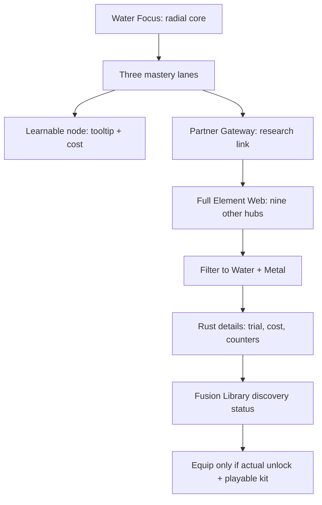

# Skill Web screenshot — visual and system design audit

**Classification:** Design review of an owner-supplied, generated desktop mockup. **Not a test of a running UI or a report of an implemented gameplay bug.**  
**Screenshot evidence:** The single uploaded AlderVale skill-web image in the owner conversation (approximately 16:9); **not committed to the public repository**. This public report describes visible UI details without publishing the attached image.  
**Verified implementation source:** `main` at `6fb96df2957c93a9c59f7e280a287fdee75cdc6a`, including `shared/realms.ts`, `shared/quests.ts`, `shared/combat.ts` and `shared/wardrobe.ts`.  
**Compared design:** `element-hq-v1` at `402390812bbc0ded6ccd3b3b06bd50d36ab6afdf`, including the [ten-tree proposal](../skill-tree-feasibility-2026-11-18.md), [Water tree](../skill-trees/water.md), [Metal tree](../skill-trees/metal.md), [fusion library proposal](../fusion-system-revamp-proposal.md) and [FQ-001 law](../../FUSION_QUALITY_LAW.md).

## Overall verdict

**Retain the hybrid radial + interconnected skill-web + constellation look as an attractive direction, but do not authorize implementation from this image.** The hierarchy and interaction rules are not yet reliable enough. Subjective assessment: visual identity **9/10**, thematic integration **9/10**, navigation clarity **6/10**, progression consistency **5/10**, implementation readiness **4/10**. These are design judgments, **not** measured playtest outcomes.

### What the screenshot visibly contains

- Top navigation with **Skill Trees**, **Fusion Library**, **Companions**, and **Deck**; central tabs **Water Skill Tree**, **Element Web**, and **Fusion Routes**, plus **Full Web** view selector.
- Left player sidebar: **Water Adept**, **Level 12**, **Rank 6**, **Mastery Points 6 / 10 used**, **Fusion Discoveries 1**, and a vertical **Levels 1–20** milestone list.
- Center radial Water Attunement with three spokes **Pressure**, **Purification** and **Reactive Flow**, nine outer school hubs (**Fire, Lightning, Frost, Wind, Earth, Light, Dark, Metal, Plant**) and a luminous path from **Water to Metal**.
- Right Rust gateway card labeled **Rust · Water + Metal**, green **Discovered**, three checked requirements, a short oxidation description, and a prominent **Equip Technique** button.
- Right *Hybrid Layout* explanatory box and bottom *Levels 1–20 Prototype* strip highlighting level 2 (first point), 6 (secondary study), 10 (trial opens) and 12 (Rust unlocked).

Ten total schools are represented: one central Water and nine surrounding gateways. The screenshot should not be interpreted as a playable web, a real player save, a tested Rust card, or proof that every visible link is an approved fusion.

## Findings — direct screenshot observations versus code or design conflicts

| ID | Priority | Observable evidence | Why it matters | Required design correction |
| --- | --- | --- | --- | --- |
| SW-01 | **High** | At **level 12** the sidebar says **“Mastery Points 6 / 10 used”**. | Under the unapproved **one point every two levels** example, level 12 grants **6 earned total**, so a ten-point denominator lacks an explained source. | Separate **earned / allocated / available**; with the example, show `6 earned`, `X spent`, `6-X available`, and no unexplained 10. |
| SW-02 | **High** | Rust is shown with green **Discovered**, checked trial and **Equip Technique**. | A selected recipe does **not** mean the final skill meets all four FQ-001 design gates or exists in current playable code. | Distinguish **Recipe selected (design)**, **Researchable**, **Trial open**, **Discovered by wizard**, **Equipped**, and **Playable kit approved**. A production Equip action must depend on real state. |
| SW-03 | **High** | Many small cross-links, star nodes, and loops have no apparent meaning or hover/selection explanation. | Prerequisites, optional routes, decorative sky-lines and fusion research paths are visually confusable; 45 Atlas pairs are research links, not 45 approved skills. | Use distinct edges and node shapes: **prerequisite solid**, **research dotted**, **selected bright**, **decorative inert**. Show an edge legend and one active route at a time. |
| SW-04 | **High** | The Rust card states only “Corrodes eligible defenses through water-driven oxidation.” | It does not specify targets, action/pip cost, duration, cap, eligible metal, cleanse or counterplay required by FQ-001 Q3/Q4. | Put **effect / cost / eligible targets / duration / counterplay** on the details card before any gameplay acceptance. Mark unspecified values **TBD**, never invent them. |
| SW-05 | Medium | The left column and the bottom strip both show **levels 1–20**; many labels are tiny relative to the canvas. | Redundant timelines reduce room for the actual skill graph, making small-window and zoomed layouts difficult. | Keep only a compact bottom milestone strip in desktop detail mode; use left sidebar for build, points and selected school. In narrow layouts, collapse milestones. |
| SW-06 | Medium | **Water Skill Tree** tab is selected while the entire nine-hub **Full Web** is visible. | Focus view and world web are blurred; new players cannot tell what they can actually interact with. | Default to **Water Focus** (three branches), provide **Full Element Web** as separate pan/zoom mode and **Fusion Routes** as a gateway filter. |
| SW-07 | Medium | Level 6 secondary study, level 10 Rust Trial, level 12 Rust unlock, and level 20 “Ascendant” look fixed. | None of those gates is an accepted progression mechanic; the previous study explicitly describes level bands as illustrative. | Add **Prototype schedule** marking and present these milestones as examples until owner accepts unlock rules. Separate **level threshold** from **trial completed**. |
| SW-08 | Medium | Small celestial dots, luminous links and ornate borders pack the central canvas. | Gorgeous as key art but difficult to assess for keyboard control, color-independent meanings, mobile/narrow width, reduced motion, 200%/400% zoom or screen readers from an image alone. | Produce a functional prototype with **keyboard focus order, pan/zoom/reset, optional text/list navigation, readable text at zoom, contrast and reduced-motion tests**. Mark all as **UNVERIFIED** until tested. |
| SW-09 | Medium | The right **Hybrid Layout** panel explains the design rationale to the viewer. | That is useful for internal review but would displace player tasks in a shipped screen. | Replace it in player mode with **recipe discovery history**, **recommended next action**, or **counterplay preview**. Keep rationale only in the design review. |
| SW-10 | Medium | The selected Water → Metal path is highlighted, but branch nodes don't show point costs, spent status, or locked versus learnable state. | The image can't demonstrate the promise that nodes are meaningful alternatives rather than mandatory filler. | On node click show **name, earned effect, point cost, prerequisites, allocation state, respec behavior and fusion research links**. Test locked/available/purchased/equipped states separately. |
| SW-11 | Medium | The image shows Rust without displaying other recipe contexts on the Metal/Earth/Light/Plant hubs. | Metal is deliberately reused by **Rust** and **Magnetism**. A player must be able to see that gateway overlap without interpreting it as a duplicate school. | In the Metal view show **Rust** and **Magnetism** as distinct links; **Sugar** remains Light + Plant; **Glass** exploratory; **Magma** paused. No visual promise of unlocked recipes. |
| SW-12 | Low | Race identity and perk interaction aren't part of this mockup. | Not itself a defect in a focused Water tree, but the game has **13 race passives** already. | If race hints are added, avoid race-exclusive gateways or extra numeric mastery points until balance is independently evaluated. |

**Severity labels are design-review priorities, not GitHub Issues or production defect severity.** No bug issue is filed solely from this static image.

## Screenshot-versus-source checks — evidence boundaries

| Claim | Result | Basis |
| --- | --- | --- |
| **Level 12 → Rank 6** | **PASS for existing code math** | `rankFromLevel(level) = min(20, max(1, floor((level + 1)/2)))`; at level 12 the rank is 6 |
| **Level 12 → six earned mastery points** | **Conditional** | True only under the proposed one-point-per-even-level model, not present in wizard state |
| **“6 / 10 used”** | **Needs correction** | Conflicts with the above illustrative budget unless a different ten-point grant source is disclosed |
| **Rust selected recipe** | **PASS as design decision** | Water + Metal → Rust locked as a recipe; no FQ-001 playable-kit approval |
| **Discovered / equipped Rust at level 12** | **UNVERIFIED** | Screenshot describes a hypothetical player state; no real skill-tree feature, earned save or approved trial schedule |
| **Only ten elemental schools** | **PASS in current design** | Water center + nine outer icons represent the intended ten schools, though the active game still has a legacy 15-ID model |
| **Two companions required in battle** | **Not shown / not decided** | Proposed card-first model avoids dual-active requirement; current combat tracks one active creature index |
| **Accessibility and responsive behavior** | **UNVERIFIED** | A static 16:9 mockup cannot prove keyboard, low-vision, touch, screen reader or resize behavior |

## Recommended interaction model — hybrid without the clutter

**Keep the beautiful celestial/woodland-heraldic styling, but structure interaction in three progressive modes:**

1. **School Focus:** default Water hub, three meaningful branch spokes, readable labels, and only immediately relevant gateway nodes.
2. **Element Web:** optional full ten-school constellation with pan/zoom and nine visible Water partner gateways, not dozens of unclassified crossings.
3. **Fusion Routes:** a filtered route and details pane that displays owner recipe state separately from that wizard's personal unlock, and tells a player what to do next.

**Suggested status taxonomy:** `Design candidate` / `Owner-selected recipe` for editorial records; `Unknown` / `Researchable` / `Trial open` / `Discovered` / `Equipped` for actual gameplay states. Do not use a green unlocked badge for both.

## Acceptance criteria before a UI implementation

- [ ] **A1 — Progression truth:** every shown point amount equals the selected point formula and saved allocation; at level 12 under the illustrative even-level rule, 6 total points earned, never an unexplained 10.
- [ ] **A2 — Status truth:** selected design recipes cannot masquerade as game-unlocked cards. Earning Rust requires a real quest or other owner-approved event, with server-backed persistence and no duplicate claims.
- [ ] **A3 — Graph semantics:** each edge is typed and has clear focus/hover/keyboard feedback. All **45 canonical pair routes** link to both relevant element charts, while locked playable recipes are filtered separately.
- [ ] **A4 — FQ-001:** Rust cannot be considered playable until Q1–Q4 are demonstrated, including action cost, duration, eligible surfaces and meaningful counterplay.
- [ ] **A5 — Accessibility:** both large and narrow screens work with zoom and pan plus a text-list alternative; no color-only status; keyboard focus, accessible labels, reduced motion and high zoom are verified in actual UI.
- [ ] **A6 — Layout:** left player summary and bottom timeline do not duplicate long milestone lists; right panel prioritizes player actions instead of designer commentary.
- [ ] **A7 — School invariants:** ten schools, Rust/Sugar/Magnetism selected recipes, Glass exploratory, Magma paused; Metal may lead to both Rust and Magnetism.
- [ ] **A8 — Engineering scope:** no UI, progression, save, race or elemental gameplay implementation without separate owner-approved scope and exact-checkout public-runner evidence.

## Evidence and CI limitations

- **Direct visual audit:** performed by inspecting the attached image in the conversation. The image is **not uploaded to a public repository**.
- **GitHub verification:** standard GitHub-hosted Ubuntu Element HQ workflow can verify that this public audit, the links to its design sources, the FQ-001 law, the 45-pair Atlas and skill-tree chart mirrors are valid at the exact branch SHA.
- **Not visually tested by CI:** screenshot pixel fidelity, real browser layouts, keyboard interactions, color/contrast readings, pan/zoom, touch, screen-reader behavior, and server unlocks. CI passing **does not** certify these features.
- **Planning fit:** the active private milestone concerns a guest first-playable loop, not skill-tree implementation. **Milestone fit unverified** for expanding into a new gameplay UI. This audit is documentation only.

**Recommendation:** **Retain the hybrid style, revise the information hierarchy and statuses, then test one clickable Water → Metal → Rust focus screen against a simpler quest-only alternative before committing to all ten live trees.** No new locks, new playable features, merge or release are authorized by this audit.
